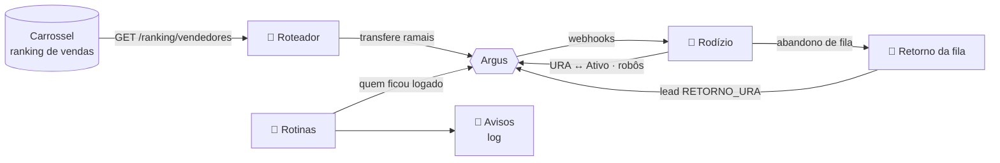
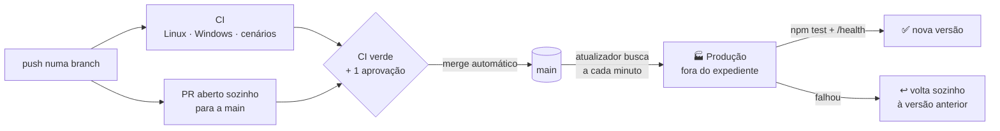

<div align="center">

# 📞 BenURA

**Automações da discadora Argus**<br>
roteador de vendas · rodízio da URA · retorno de quem desistiu da fila · rotinas de fim de expediente

[](https://github.com/nanzinx/Benura/actions/workflows/ci.yml)


[Início rápido](#inicio-rapido) ·
[Roteador](#roteador) ·
[Rodízio](#rodizio) ·
[Retorno da fila](#retorno-da-fila) ·
[Fim de expediente](#fim-de-expediente) ·
[PM2](#pm2) ·
[Esteira](#esteira)

</div>

---

## 📚 Sumário

- [Visão geral](#visao-geral)
- [Início rápido](#inicio-rapido)
- [🚦 Roteador de Vendas](#roteador)
- [🔄 Rodízio Ativo ↔ URA e robôs](#rodizio)
- [📲 Retorno de quem desistiu da fila](#retorno-da-fila)
- [🌙 Fim de expediente limpo](#fim-de-expediente)
- [🛡️ Conflitos e proteções](#conflitos)
- [🧰 Rodando com PM2](#pm2)
- [🚀 Esteira automática](#esteira)

<a id="visao-geral"></a>
## 🧭 Visão geral

| Script | App no PM2 | Porta | O que faz |
|---|---|---|---|
| `roteador-vendas.js` | `benura-roteador` | 3001 | Distribui vendedores entre **URA** e **Ativo** com base nas vendas da **API do Carrossel** |
| `argus-automacao.js` | `benura-rodizio` | 3000 | Rodízio Ativo ↔ URA por atendimento, liga/desliga os robôs da URA e faz o **retorno de quem desistiu da fila** |
| `rotinas.js` | `benura-rotinas` | 3003 | Rotinas diárias: **fim de expediente limpo** |
| `atualizador.js` | `benura-atualizador` | 3002 | Deploy automático na máquina de produção, fora do expediente |



> [!NOTE]
> Toda automação nova nasce **desligada** ou em modo **só relatar**, e todas respeitam `DRY_RUN=1` (registra o que faria, sem mexer em nada).

<a id="inicio-rapido"></a>
## ⚡ Início rápido

```bash
npm install
cp .env.example .env     # URL do Carrossel, token da Argus, GRUPO_URA_ID e GRUPOS_ATIVOS_IDS
npm run dev              # tudo simulado em memória, sem rede
npm test                 # testes unitários
npm run test:cenarios    # cenários do rodízio contra uma Argus falsa
```

> [!TIP]
> No **PowerShell**, use `copy .env.example .env`. Para variáveis de ambiente, use `$env:NOME='valor'; npm run ...`.

---

<a id="roteador"></a>
## 🚦 Roteador de Vendas

### Regras de negócio
1. **Carga inicial** (primeiro ciclo do expediente): quem vendeu **mais** que `META_DIARIA` no dia útil anterior vai para a URA.
   Os demais, inclusive quem não vendeu nada, vão para o Ativo, no grupo **do próprio supervisor**.
   - **Operadores fixos** (`OPERADORES_FIXOS_URA`, ramais ou nomes separados por vírgula) começam o dia na URA **com ou sem venda**.
     Se a carga for adiada (Carrossel fora e sem esteira colada), eles vão para a URA mesmo assim.
     Depois seguem o rodízio como todos: ociosos por `TEMPO_MIN` vão para o Ativo e voltam à URA quando atendem lá.
   - **Equipes fixas** (`EQUIPES_FIXAS_URA`, nomes de supervisores como na Argus, separados por vírgula): toda a equipe do supervisor é tratada como fixa. Ex.: `EQUIPES_FIXAS_URA=ROBSON JUNIOR` põe a equipe do Robson na URA todo dia. O ocioso volta ao grupo do supervisor; para garantir o grupo certo, coloque-o também no `supervisores-grupos.json` (ex.: `{ "ROBSON JUNIOR": 20 }`). Nome que não bater com um supervisor da Argus gera um aviso no log.
2. **Gatilho**: quem está no Ativo e faz qualquer venda hoje sobe para a URA e fica lá até o fim do dia.
3. **Reset**: no dia seguinte (no fuso `FUSO_HORARIO`) o ciclo recomeça.

### Como rodar
```bash
npm start
```
| Modo | Comando |
|---|---|
| Sem rede (Carrossel e Argus em memória) | `npm run dev` |
| Simulação completa com PM2 | veja [Rodando com PM2](#pm2) |
| Mock HTTP de Carrossel + Argus | `npm run mock` (veja `.env.example`) |

### Independência da URA
O `DiscadoraService` é a única porta para a Argus e segue estas regras:
- **A Argus é a fonte da verdade**: antes de transferir, consulta em que grupo o ramal está.
- **Idempotência**: se o ramal já está no destino (ex.: movido à mão), nada é enviado.
- **Grupos externos respeitados**: quem foi colocado manualmente em outro grupo (treinamento, supervisão…) não é puxado de volta (`RESPEITAR_GRUPOS_EXTERNOS=1`).
- **Sem reconciliação contínua**: o roteador só age em eventos (carga do dia, venda detectada), nunca "corrige" a URA periodicamente.
- **Falhas não derrubam nada**: transferências que falharam ficam pendentes e são tentadas de novo (até 5×/dia).
- **Ativo = grupo do supervisor**: o Ativo são vários grupos (`GRUPOS_ATIVOS_IDS`), um por supervisor.
  Quem já está em qualquer um deles fica onde está; quem volta da URA vai para o grupo do próprio supervisor.

### API do Carrossel
Consome `GET {CARROSSEL_API_URL}/ranking/vendedores` do Carrosel-BenApi, que devolve
`{ hoje: [...], ontem: [...], semanal, mensal, ultimaExtracao, diaOntem }`.
- **Total vendido**: campo `CARROSSEL_METRICA` (padrão `vendaConcluida`) da linha `GERAL` de `performance`.
- **"Ontem"** é o dia útil anterior calculado pelo próprio Carrossel (pula fim de semana e feriados).
- **Atualização**: o Carrossel refaz o scraping a cada 6 min; um poll de 1 min é suficiente.
- Se o Carrossel responder `ultimaExtracao: "Erro"` ou vier sem vendas de ontem, a carga do dia é adiada e tentada de novo.
- Só `src/integrations/carrossel/carrossel.mapper.js` conhece esse formato.

### Carrossel fora do ar: esteira colada
Se o Carrossel cair (ou responder `ultimaExtracao: "Erro"`), o roteador usa a **esteira colada à mão** com as mesmas regras.
Quando o Carrossel volta, ele volta a ser a fonte.

1. Na esteira, filtre **Etapa = Andamento** e o período por **data de cadastro**, incluindo o **dia anterior trabalhado e hoje**.
2. Abra `http://localhost:3001/manual` e escolha o CSV exportado, **ou** copie a tabela (com o cabeçalho) e cole.
3. Clique em **Enviar**. A página mostra quem passou da meta no dia anterior e quem vendeu hoje.
   - Durante o dia, cole de novo para atualizar as vendas de hoje.
4. Para apagar tudo o que foi colado, clique em **Limpar esteiras coladas** (pede confirmação e o token).

Detalhes:
- **Colunas usadas:** só `Agente`, `Valor Contrato` e `Data/Hora` (cadastro). `Proposta`, se vier, evita contar a mesma proposta duas vezes.
- **"Dia anterior":** o **último dia trabalhado**, ou seja, a data mais recente antes de hoje com vendas na esteira. Segunda-feira usa a sexta; depois de feriado, usa o dia útil.
- **Colagens se somam por dia:** cada colagem substitui só os dias que contém. Dá para colar a esteira de ontem e a de hoje separadamente.
- **Validade:** só vale a esteira colada **hoje**. Guarda os 7 dias mais recentes. O arquivo é `ESTEIRA_MANUAL_FILE`, padrão `state-esteira-manual.json`.
- **Proteção:** se houver `WEBHOOK_TOKEN`, a página pede o token.

### Vendedor do Carrossel → ramal da Argus (automático)
O Carrossel identifica vendedores **só pelo nome**; a Argus só entende **ramal**. A ponte é feita
automaticamente pelo `/listarusuarios` da Argus, que traz nome, login, ramal, grupo e supervisor de todos os usuários.
- Nomes são comparados sem acento, maiúsculas ou espaços extras.
- **Universo da carga**: operadores ativos que estão hoje na URA ou em algum grupo do Ativo. Quem não aparece no "ontem" do Carrossel vendeu R$ 0.
- **Grupo de cada supervisor**: inferido pelo grupo do Ativo onde está a maioria dos operadores dele (não depende do nome do grupo).
- **Exceções** (opcionais, relidas sem reiniciar):
  - `vendedores-ramais.json`: nome no Carrossel diferente do nome na Argus, ou homônimos: `{ "NOME NO CARROSSEL": "2266111" }`
  - `supervisores-grupos.json`: supervisor cujo grupo não é identificado: `{ "NOME DO SUPERVISOR": 12 }`
    - Para conferir todos de uma vez (só lê a Argus): **`npm run conferir:supervisores`**. Mostra o grupo do Ativo de cada supervisor e por qual regra foi encontrado (arquivo, pela equipe, pelo nome do grupo), quem ficou **sem grupo** e os **operadores sem supervisor** (esses precisam ser corrigidos na Argus). Grava `supervisores-grupos.sugerido.json` com todos os supervisores: troque cada `null` pelo número do grupo e renomeie para `supervisores-grupos.json` (relido sozinho, sem reiniciar). Grupo `null` ou `0` no arquivo é ignorado.

### Endpoints HTTP do roteador
| Método | Rota | Auth | Descrição |
|---|---|---|---|
| `GET` | `/health` | — | saúde do serviço |
| `GET` | `/status` | — | vendedores por fila, pendências |
| `POST` | `/recarregar` | 🔒 token | refaz a carga inicial |
| `POST` | `/webhook/venda` | 🔒 token | `{ "ramal": "1004", "valor": 1500 }` |
| `GET` | `/manual` | — | página para colar a esteira |
| `POST` | `/manual` | 🔒 token | `{ "texto": "<esteira>" }` → resumo |
| `DELETE` | `/manual` | 🔒 token | apaga as esteiras coladas → `{ "apagados": <dias> }` |

Token: `Authorization: Bearer <WEBHOOK_TOKEN>` ou `X-Webhook-Token: <WEBHOOK_TOKEN>`.

<details>
<summary><b>🏗️ Arquitetura (pastas)</b></summary>

```
roteador-vendas.js                 ponto de entrada
src/app.js                         composition root + ciclo de vida
src/config/                        variáveis de ambiente (dotenv) + validação
src/http/server.js, controllers.js rotas → controladores (sem regra de negócio)
src/services/roteamento.service.js casos de uso: carga inicial, monitoramento, webhook
src/services/agendador.js          loop único, sem sobreposição, respeita expediente
src/domain/                        regras puras (meta, gatilho, rodízio, retorno da fila, fim de expediente)
src/integrations/carrossel/        client HTTP → mapper (anti-corrupção) → service (fallback)
src/integrations/argus/            client HTTP → DiretorioOperadores (usuários) → DiscadoraService (isola a URA)
src/repositories/                  estado diário, exceções de ramal, auditoria (JSONL)
src/rodizio/                       rodízio Ativo ↔ URA e robôs
src/retorno-fila/                  retorno de quem desistiu da fila
src/rotinas/                       rotinas diárias (fim de expediente)
src/notificacoes/                  avisos (log)
src/atualizador/                   deploy automático
src/utils/                         HTTP com retry, persistência atômica, trava de processo, laços periódicos
```

</details>

---

<a id="rodizio"></a>
## 🔄 Rodízio Ativo ↔ URA e robôs

`argus-automacao.js` · lógica em `src/rodizio/` · regras puras em `src/domain/rodizio.js`

### Regras
1. **Ativo → URA**: operador **elegível** do Ativo que **atendeu** uma ligação e ficou **livre** vai para a URA. Se ficar offline antes, perde esse histórico.
   - **Elegível** = quem o roteador pôs na URA hoje: bateu a meta ontem, vendeu hoje ou é fixo (fila `URA` no `state-vendas.json` do roteador). Quem vende durante o dia passa a ser elegível na hora. Os demais ficam só no Ativo.
   - Sem a lista do dia (roteador desligado, carga adiada porque o Carrossel falhou, arquivo de outro dia), **todos** sobem, como antes, e o log avisa uma vez.
   - O `/health` mostra `elegiveisUra: { disponivel, total }`. Para voltar a girar todos sempre: `RODIZIO_SO_ELEGIVEIS=0`.
2. **URA → Ativo**: **qualquer** humano do RECEPTIVO - URA **ocioso (Livre) há `TEMPO_MIN` minutos seguidos** (padrão 3) volta ao Ativo, **sem exceção**: nem o último livre, nem na URA cheia.
   Atender uma ligação (ou entrar em pausa) zera a contagem, como a coluna "Tempo" do painel.
   - Quem o rodízio moveu volta ao **grupo de origem**; os demais (colocados à mão, pelo roteador ou antes de o programa iniciar) voltam ao **grupo do supervisor** (diretório da Argus ou `SUPERVISORES_GRUPOS_FILE`). O grupo do supervisor é o grupo do Ativo com a maioria da equipe dele; se não houver ninguém da equipe no Ativo, o grupo cujo nome começa pelo primeiro nome do supervisor ("ROBSON - COMERCIAL"). Sem grupo identificável, fica na URA com um aviso.
   - **O último livre sai no horário, e os robôs param antes.** Sem livre na URA, o alvo vira 0 e um robô em ligação que derivar não acha ninguém (callback). Por isso, quando o último livre está a `PREPARAR_SAIDA_ULTIMO_LIVRE_MS` (**90 s**, no máximo metade do `TEMPO_MIN`) de completar o tempo ocioso, os robôs param de discar e os que estão em ligação terminam enquanto ele ainda está na URA. Se ele atender ou aparecer outro livre, os robôs voltam. O `/health` mostra `ultimoLivreSaindo`.
   - Quem o rodízio moveu e ficou offline volta na hora.

### URA cheia (todos na URA)
Quando pedirem todo mundo na URA, abra **`http://localhost:3000/ura`** e clique em **Colocar todos na URA** (pede o `WEBHOOK_TOKEN`, se configurado).
- Em até 5 s, todos os operadores dos grupos do Ativo (`GRUPOS_ATIVOS_IDS`) vão para a URA, atendendo ou não, sem olhar elegíveis. Quem entrar depois no Ativo também sobe (uma vez).
- **A regra do ocioso continua valendo**: quem ficar livre `TEMPO_MIN` seguidos volta ao Ativo e sobe de novo ao atender lá, mesmo sem ser elegível. Os robôs continuam proporcionais aos livres (`ROBOS_POR_LIVRE`), até o total de robôs, e a telefonia continua sendo conferida.
- **Voltar ao normal**: só os elegíveis voltam a subir do Ativo.
- Vale até desligar ou até virar o dia; sobrevive a reinício (`RODIZIO_URA_CHEIA_FILE`). O `/health` mostra `uraCheia: { ligada, desde }`.
- Pela API: `POST /ura/cheia` liga e `DELETE /ura/cheia` desliga (com token).
- Com a URA cheia ligada, quem a carga das 08:00 do roteador mandar para o Ativo volta para a URA no ciclo seguinte.
   - Quem voltou retorna à URA pela regra 1, assim que atender no Ativo.
3. **A telefonia demora a acompanhar a troca de grupo** (visto na operação em 14/10/2026).
   - Mover alguém de grupo (pelo painel ou pela API) muda a **Lista de Operadores** na hora. A **telefonia** (o painel "Operadores Online" do grupo, `statusoperador.idGrupo`) só troca quando a pessoa fica **livre**, com um atraso da discadora. Em ligação ou pausa, espera.
   - Enquanto isso, a derivação dos robôs **não chega** nela. Por isso o BenURA só conta como livre na URA (e só liga robô para) quem já está **logado na URA**.
   - Quem continua no grupo antigo por mais de `ALINHAR_LOGIN_APOS_MS` (**30 s**) ficou preso (ex.: no preditivo, emendando ligação). Aparece um aviso e, se estiver livre, o BenURA **reloga** a pessoa (`logaroperador`, que loga no grupo vinculado; se não bastar, desloga e loga). Isso vale também para quem foi movido à mão. Desligue com `ALINHAR_LOGIN_APOS_TRANSFERIR=false`.
4. **Robôs proporcionais aos livres**: ficam ligados `ROBOS_POR_LIVRE` robôs (padrão **7**) por humano **livre** no RECEPTIVO - URA.
   Com 1 livre, 7; com 2 livres, 14; e assim por diante, até o total de robôs (ou `ROBOS_MAXIMO`). Muitos robôs para poucos livres geram callback.
   - **Ninguém livre** → todos desligados **na hora**. **Com gente livre**, a redução só acontece se a queda de livres durar `ROBOS_REDUZIR_APOS_MS` (**10 s**), para não reagir a cada piscada de status, e desliga **só os robôs que não estão em ligação**: derrubar um robô falando corta o cliente e vira callback. Os que estão em ligação saem nos ciclos seguintes, quando a ligação termina (o log mostra "N em ligação mantidos até terminar").
   - **Aumentar** espera `MIN_ROBOS_OFF_MS` (padrão **15 s**) desde a última redução e sobe **em degraus**: no máximo `ROBOS_DEGRAU` (**7**) robôs a cada `ROBOS_SUBIDA_INTERVALO_MS` (**10 s**). Religar todos de uma vez faz todos discarem juntos, as derivações chegam juntas e o excedente vira callback.
   - A URA é lida a cada `POLL_URA_MS` (**5 s**). Com **1 a `LIVRES_ALERTA` (2) livres** ela entra **em alerta** e passa a ser lida a cada `POLL_URA_ALERTA_MS` (**1 s**): o próximo atendimento pode zerar os livres com robôs ligados.
   - Robô que liga ou desliga **sem comando do BenURA** (outra cópia, script antigo, painel) gera um aviso no log e conta em `/health` (`robos.mudancasPorFora`).
   - **Modo manual**: `POST /robos/manual` `{ "minutos": 30 }` (com token) faz o BenURA parar de mexer nos robôs para a supervisão assumir pelo painel; `POST /robos/automatico` devolve.
   - **Ajuste pelos callbacks** (`ROBOS_AJUSTE_CALLBACK=1`, padrão): o 7 é a média; num dia de URA mais agressiva, cada callback baixa um degrau de robôs por livre (7→6→5…, até `ROBOS_POR_LIVRE_MINIMO`, padrão **4**). Sem callback por `ROBOS_RECUPERAR_APOS_MIN` (**15 min**), sobe um degrau de volta, até o `ROBOS_POR_LIVRE`.
     - O sinal é o webhook **encerramento de URA (tipo 5)** com "abandonou a fila" ou "time-out na fila": é o "Gerou Callback" do painel. Precisa estar configurado na Argus apontando para `POST /webhook?token=…` (o mesmo do retorno da fila).
     - Cada callback aparece no log com a situação da URA naquele instante: `Callback (abandonou a fila) com 1 livre(s) na URA e 7 robô(s) ligado(s): robôs por livre 7→6.` Isso ajuda a explicar callbacks que não deveriam acontecer.
     - Só baixa: a redução segue as regras acima (não derruba robô em ligação). No máximo um degrau a cada `ROBOS_AJUSTE_INTERVALO_S` (**60 s**), o mesmo evento reenviado conta uma vez, e no modo manual o callback é registrado mas não ajusta. Ao reiniciar, volta ao `ROBOS_POR_LIVRE`.
     - O `/health` mostra `ajusteRobos: { porLivre, base, piso, callbacks, ultimoCallback }`.
   - **Ninguém livre** (todos ocupados ou em pausa, URA vazia ou offline, ou a Argus sem responder) → **todos desligados** na hora.
   - Os grupos dos robôs ficam em `GRUPOS_ROBOS_URA_IDS` (hoje URA PORT 3). A cada atualização de grupos, o rodízio confere na Argus quais robôs estão de fato ligados.
   - O `/health` mostra `robos: { ligados, alvo, total, porLivre, mudancasPorFora, manualAte }`, `intervaloUraMs` e `ultimoWebhook`.
5. **Webhook** (`POST /webhook?token=...`): o início de atendimento chega antes do polling e desliga os robôs na hora.
   Se nenhum webhook chegar em 1 h com robôs ligados, o log avisa que ele não está configurado.

### Diagnóstico de callbacks
Para descobrir **quando** e **por que** os robôs geram callback:

1. **Linha do tempo no log do rodízio.** A cada mudança no número de livres, o log mostra uma linha:
   `URA: livres 2→1 | humanos 3 | robôs ligados 14 (alvo 7)`.
   Rodando pelo PM2, o log fica em `logs/rodizio.out.log`.
2. **Relatório dos robôs, só leitura:**
   ```bash
   npm run diagnostico:callbacks                    # hoje, desde a meia-noite
   npm run diagnostico:callbacks -- --minutos 120   # só os últimos 120 min
   ```
   Ele busca na Argus o relatório de ligações detalhadas dos grupos de robôs (`GRUPOS_ROBOS_URA_IDS`) e mostra:
   - os campos do relatório e a contagem por status/resultado;
   - a linha do tempo de 15 em 15 min: derivou (`ATENDIMENTO`), callback (`OPER. VIRTUAL - ABANDONO EM FILA`, que é o "Gerou Callback" do painel) e sem agente (do discador);
   - cada callback com hora e robô;
   - **"Quem está na URA agora":** em que grupo cada pessoa da URA está **logada na telefonia** (status do operador, só leitura). `ATENCAO: LOGADO EM OUTRO GRUPO` quer dizer que a pessoa aparece na URA, mas a derivação dos robôs não chega nela.
   Também grava o resultado em `logs/diagnostico-callbacks-AAAA-MM-DD.json`. CPF, telefone, nome do cliente e lead são descartados antes de imprimir ou gravar.

3. **Aviso no rodízio:** quem está no grupo da URA mas logado na telefonia em outro grupo gera um aviso no log (uma vez por ramal) e aparece em `uraLogadosEmOutroGrupo` no `/health`. Com `DRY_RUN=1` o rodízio só avisa e registra `[DRY_RUN] Relogaria ...`.

Compare a hora de cada callback com a linha do tempo daquele minuto.

### Testes de comportamento
`npm run test:cenarios` sobe uma Argus falsa e roda o rodízio de verdade em **27 cenários**: ida, volta, robôs proporcionais, webhook, correções e retorno da fila.
A mesma suíte roda contra outra versão do script: `node test/rodizio/cenarios.js caminho/para/versao.js`. Foi assim que a
refatoração foi comparada com o script original.

<details>
<summary><b>🐞 Correções em relação ao script original</b></summary>

- **HTTP 403** (token inválido) era tratado como limite de requisições e o script pausava para sempre, em silêncio. Agora é um erro claro sobre o token; o limite de requisições de verdade é o **429**.
- **Trava órfã**: depois de uma queda abrupta, `argus.lock` impedia o reinício (o PM2 ficava em loop). Agora a trava guarda o PID e é reaproveitada se o processo dono não existe mais.
- **Webhook tipo 5**: a documentação da Argus escreve `FidConclusaoDerivacao` no exemplo; os dois nomes são aceitos.
- **Rodada lenta**: o alerta de ciclo lento nunca disparava; agora avisa quando uma rodada passa de 5 s.

</details>

<details>
<summary><b>🔧 Mudança de configuração</b></summary>

A porta e os arquivos passaram a ter nomes próprios, para rodar ao lado do roteador com o mesmo `.env`:
`RODIZIO_PORT` (padrão 3000, antes `PORT`), `RODIZIO_STATE_FILE` (padrão `state.json`) e `RODIZIO_LOCK_FILE` (padrão `argus.lock`).
As demais variáveis continuam com o mesmo nome. O `state.json` existente é aproveitado.

</details>

---

<a id="retorno-da-fila"></a>
## 📲 Retorno de quem desistiu da fila

O cliente que liga na URA e desiste de esperar é o lead mais quente que existe. O rodízio já recebe os webhooks
da Argus em `POST /webhook`; com esta automação ligada, o webhook **tipo 5 (Encerramento de URA)** passa a:

| Conclusão da URA | O que acontece |
|---|---|
| `2` ABANDONOU FILA · `3` SEM AGENTE · `4` TIME-OUT FILA | ➕ o telefone entra como lead na skill `RETORNO_SKILL_HASH`, com `origem = RETORNO_URA`, `info0` = motivo e `info1` = serviço da URA |
| `1` DERIVOU (o cliente ligou de novo e foi atendido) | ➖ o retorno pendente desse telefone é **removido** da skill (`/excluir` pelo `codCliente`) |

- **Sem duplicar**: o mesmo telefone gera um retorno só dentro de `RETORNO_JANELA_HORAS` (padrão 4 h), mesmo que ligue e desista várias vezes.
- **Skill existente**: nenhuma skill nova é criada. O hash aparece no `/listarskills` ou na tela da skill. Meça o resultado nos relatórios da Argus filtrando `origem = RETORNO_URA`.
- **Ligações fora do horário** também viram retorno (`RETORNO_INCLUIR_FORA_HORARIO=true`); com `false`, são ignoradas.
- Cada decisão vai para `logs/retorno-fila.jsonl` (incluído, duplicado, removido, falha). A Argus fora do ar nunca atrasa a resposta ao webhook.

**Como ligar:**
1. Na Argus, configure o webhook **Encerramento de URA (tipo 5)** para a mesma URL do rodízio: `http://SEU-SERVIDOR:3000/webhook?token=SEU_WEBHOOK_TOKEN`.
2. No `.env`, preencha `RETORNO_SKILL_HASH=<hash da skill>` e, para ensaiar, `DRY_RUN=1` (só registra o que faria).
3. Coloque `RETORNO_FILA_ATIVO=true` e reinicie o `benura-rodizio`.

> [!WARNING]
> Com `RETORNO_FILA_ATIVO=true` e sem `RETORNO_SKILL_HASH`, o rodízio não sobe e diz o motivo no log.

---

<a id="fim-de-expediente"></a>
## 🌙 Fim de expediente limpo

`rotinas.js` · app `benura-rotinas` · lógica em `src/rotinas/`

Todo dia, `FIM_EXPEDIENTE_MARGEM_MIN` minutos (padrão 10) depois de `HORARIO_FIM`, confere quem continua logado na Argus:

| `FIM_EXPEDIENTE_ACAO` | O que faz |
|---|---|
| `relatar` (padrão) | só avisa a lista de quem ficou logado |
| `deslogar` | também desconecta quem está fora de atendimento |

> [!IMPORTANT]
> Quem está **em atendimento nunca é deslogado**, porque derrubaria a ligação do cliente; só aparece no aviso.
> Robôs (`GRUPOS_ROBOS_URA_IDS`), grupos virtuais e os ramais de plantão em `FIM_EXPEDIENTE_IGNORAR_RAMAIS` ficam de fora. Respeita `DRY_RUN`.

O aviso sai pelo notificador (log do processo + `logs/notificacoes.jsonl`) e o relatório completo vai para `logs/fim-expediente.jsonl`.

```bash
npm run rotinas:agora                 # confere se já está na hora e sai
npm run rotinas:agora -- --forcar     # executa já, ignorando o horário

# Ensaio sem Argus real (operadores simulados: 1001 livre, 1002 em atendimento, 1008 em pausa)
USAR_MOCK=1 ARGUS_TOKEN=x FIM_EXPEDIENTE_ACAO=deslogar npm run rotinas:agora -- --forcar
```

> [!TIP]
> No PowerShell, defina as variáveis antes: `$env:USAR_MOCK=1; $env:ARGUS_TOKEN='x'; npm run rotinas:agora -- --forcar`

---

<a id="conflitos"></a>
## 🛡️ Conflitos e proteções

O roteador, o rodízio, as rotinas e a supervisão (pelo painel) mexem nos mesmos grupos da Argus. O que cada conflito causaria e como o BenURA se protege:

| | Conflito | Proteção |
|---|---|---|
| C1 | Roteador e rodízio decidiam sobre o mesmo vendedor sem se falar | Regra única na URA: todo ocioso há `TEMPO_MIN` volta ao Ativo; só os elegíveis do roteador (meta ontem, venda hoje, fixo) retornam à URA ao atender no Ativo |
| C2 | Duas cópias (PM2 + janela, dois PCs, script antigo) brigam pelos robôs | Trava de instância em roteador, rodízio e rotinas; aviso de robôs mexidos por fora |
| C3 | Sem webhook, os robôs ficavam até 5 s ligados depois que o último livre atende | URA em alerta (lê a cada 1 s com 1 a 2 livres); aviso quando nenhum webhook chega |
| C4 | Robôs sobem e descem a cada oscilação de livres; religar em rajada gera derivações juntas | Redução parcial só após 10 s de queda confirmada (ninguém livre segue imediato); subida em degraus de 7 a cada 10 s |
| C5 | O rodízio desfazia o que a supervisão fazia no painel | `POST /robos/manual` / `POST /robos/automatico` |
| C6 | `.env` antigo anulava correções novas | Aviso ao iniciar para valores que já causaram problema |
| C7 | Cada processo pausava sozinho num HTTP 429 | Pausa compartilhada em `ARGUS_PAUSA_FILE` |
| C8 | Carrossel e esteira colada usam critérios diferentes | `/status` mostra a fonte da carga e de cada promoção; aviso quando o Carrossel volta |
| C9 | Supervisor move alguém à mão | Esperado: o roteador respeita grupos externos e o rodízio esquece o emprestado em ~1 min |
| C10 | Fim de expediente com `deslogar` desconectaria o plantão | Aviso quando `deslogar` está sem `FIM_EXPEDIENTE_IGNORAR_RAMAIS` |
| C11 | Lista mudou, mas a telefonia só troca quando a pessoa fica livre | Só conta como livre na URA quem já está logado nela; quem fica preso é relogado após 30 s livre |
| C12 | Rodízio sem a lista do dia do roteador | Gira todos, como antes, e avisa (`elegiveisUra.disponivel: false`) |
| C13 | Ajuste pelos callbacks reagindo a callback que não foi excesso de robôs (telefonia, modo manual) | Só baixa, com piso e um degrau por minuto; volta sozinho em 15 min; no modo manual não ajusta |
| C14 | Exceções à regra do ocioso (último livre segurado, URA cheia) | A regra vale sempre; o último livre sai no horário e os robôs param antes (`PREPARAR_SAIDA_ULTIMO_LIVRE_MS`) |

**Regra de ouro:** um PC só, um jeito só de iniciar (PM2 **ou** janelas). Para conferir: `npx pm2 list` e `Get-Process node`.

<a id="pm2"></a>
## 🧰 Rodando com PM2

O PM2 já vem como dependência de desenvolvimento: depois do `npm install`, os comandos abaixo funcionam
sem instalar nada global (Windows, Linux ou macOS). Requer **Node.js 22 LTS** ou superior.

### 🧪 Simulação local (sem Carrossel nem Argus reais)

Sobe dois processos: `benura-mock` (imita as APIs do Carrossel e da Argus na porta 8081) e
`benura-roteador-sim` (o roteador de verdade, na porta 3001, apontando para o mock).
O `.env` **não** é lido nessa simulação, então um `.env` de produção na pasta não interfere.

```bash
npm run sim:iniciar              # sobe tudo (e limpa o estado da simulação anterior)
npm run sim:status               # quem está na URA e no Ativo
npm run sim:logs                 # acompanha os logs (Ctrl+C para sair)
npm run sim:venda -- 1006 2500   # simula uma venda do ramal 1006 via webhook
npm run sim:parar                # derruba tudo
```

O que acontece na simulação:
1. **Carga inicial**: quem vendeu mais de R$ 50 mil "ontem" vai para a URA (1001, 1002, 1003); os demais ficam no Ativo, cada um no grupo do seu supervisor.
2. **Após 2 min**: RICARDO MENDES (1004) vende no "Carrossel" e o roteador o sobe para a URA sozinho. **Após 5 min**: JULIANA ALVES (1005).
3. **Webhook**: `sim:venda` promove na hora quem estiver no Ativo.

Estado e logs da simulação ficam em `.simulacao/`. `npx pm2 monit` abre um painel com CPU, memória e logs.

### 🏭 Produção

Usa o `.env` (copie de `.env.example`).

```bash
npm run pm2:iniciar      # sobe o benura-roteador, o benura-rodizio e o benura-rotinas
npx pm2 start ecosystem.config.js --only benura-rodizio   # só um deles
npx pm2 logs
npm run pm2:parar
```

- Sem configuração válida o serviço não sobe: o motivo aparece em `logs/*.err.log` e o PM2 tenta de novo com espera crescente.
- O desligamento é gracioso (o estado do dia é salvo antes de sair), inclusive no Windows.
- Para iniciar junto com o sistema: `npx pm2 save` e `npx pm2 startup` (Linux/macOS); no Windows, use o pacote `pm2-installer`.

---

<a id="esteira"></a>
## 🚀 Esteira automática



- **Toda branch** entra na esteira, exceto `main` e `wip/**` (use `wip/` para rascunhos que não devem virar PR).
- **CI** (`.github/workflows/ci.yml`): `unitarios-linux`, `unitarios-windows` e `cenarios` rodam em todo push e PR.
- **PR automático** (`.github/workflows/pr-automatico.yml`): abre um PR por branch (uma vez) e liga o merge automático.
  O merge só acontece com os três checks verdes **e** uma aprovação humana.
- **Deploy** (`atualizador.js`): roda **na máquina de produção** e *busca* a `main`, sem precisar de IP público, porta aberta nem SSH.
  - Só atualiza fora do expediente: em dias úteis, fora de `HORARIO_CARGA`–`HORARIO_FIM`; sábado e domingo são livres.
  - Antes de recarregar, roda `npm test` na própria máquina; depois, espera o `/health` dos serviços. Qualquer falha volta ao commit anterior.
  - Não atualiza se houver alteração local em arquivo versionado ou se a cópia local divergiu da `main`.
  - Histórico em `logs/deploy.jsonl`; estado em `GET http://localhost:3002/health`.

### Configuração única no GitHub (precisa de admin do repositório)
1. **Settings → General → Pull Requests**: marque **Allow auto-merge** (e, se quiser, *Automatically delete head branches*).
2. **Settings → Actions → General → Workflow permissions**: **Read and write permissions** e **Allow GitHub Actions to create and approve pull requests**.
3. **Settings → Branches → Add branch protection rule** (ou *Rulesets*) para `main`:
   - *Require a pull request before merging* → *Require approvals*: **1** → *Dismiss stale pull request approvals when new commits are pushed*;
   - *Require status checks to pass*: `unitarios-linux`, `unitarios-windows`, `cenarios` (aparecem na busca depois do primeiro CI).
4. **Settings → Secrets and variables → Actions → Variables**: crie `AUTO_MERGE_ATIVO` = `true`.

> [!WARNING]
> Crie `AUTO_MERGE_ATIVO` **só depois do passo 3**. Sem essa variável os PRs continuam abrindo sozinhos,
> mas o merge fica manual (trava de segurança).

### Ligar o deploy quando houver produção
Na máquina de produção (Windows ou Linux), com o repositório clonado, `.env` preenchido e os serviços no PM2:
```bash
npm run pm2:iniciar              # roteador + rodízio + rotinas
npm run atualizador:iniciar      # liga o deploy automático
npm run atualizador:agora        # uma verificação agora (respeita a janela)
npm run atualizador:agora -- --ignorar-janela   # emergência: atualiza mesmo no expediente
npm run atualizador:parar        # desliga
```

---

<div align="center">
<sub><b>BenURA</b> · feito para a operação de call center · Node.js + PM2 + Argus</sub>
</div>
