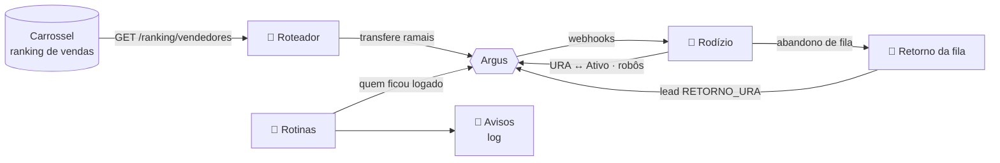
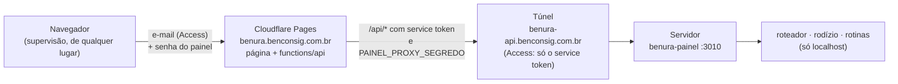
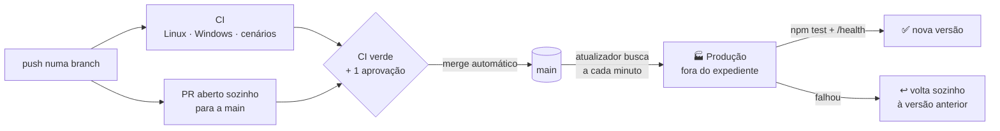

<div align="center">

# 📞 BenURA

**Automações da discadora Argus**<br>
roteador de vendas · rodízio da URA · retorno de quem desistiu da fila · rotinas de fim de expediente

[](https://github.com/nanzinx/Benura/actions/workflows/ci.yml)


[Início rápido](#inicio-rapido) ·
[Roteador](#roteador) ·
[Rodízio](#rodizio) ·
[Retorno da fila](#retorno-da-fila) ·
[Fim de expediente](#fim-de-expediente) ·
[PM2](#pm2) ·
[Esteira](#esteira)

</div>

---

## 📚 Sumário

- [Visão geral](#visao-geral)
- [Início rápido](#inicio-rapido)
- [🚦 Roteador de Vendas](#roteador)
- [🔄 Rodízio Ativo ↔ URA e robôs](#rodizio)
- [📲 Retorno de quem desistiu da fila](#retorno-da-fila)
- [🖥️ Painel da supervisão](#painel)
- [🌙 Fim de expediente limpo](#fim-de-expediente)
- [🛡️ Conflitos e proteções](#conflitos)
- [🧰 Rodando com PM2](#pm2)
- [🏢 Servidor + Cloudflare Pages](#servidor)
- [🚀 Esteira automática](#esteira)

<a id="visao-geral"></a>
## 🧭 Visão geral

| Script | App no PM2 | Porta | O que faz |
|---|---|---|---|
| `roteador-vendas.js` | `benura-roteador` | 3001 | Distribui vendedores entre **URA** e **Ativo** com base nas vendas da **API do Carrossel** |
| `argus-automacao.js` | `benura-rodizio` | 3000 | Rodízio Ativo ↔ URA por atendimento, liga/desliga os robôs da URA e faz o **retorno de quem desistiu da fila** |
| `rotinas.js` | `benura-rotinas` | 3003 | Rotinas diárias: **fim de expediente limpo** |
| `painel.js` | `benura-painel` | 3010 | **Painel da supervisão**: controles da URA, esteira manual, saúde dos serviços e o dia da URA |
| `atualizador.js` | `benura-atualizador` | 3002 | Deploy automático na máquina de produção, fora do expediente |



> [!NOTE]
> Toda automação nova nasce **desligada** ou em modo **só relatar**, e todas respeitam `DRY_RUN=1` (registra o que faria, sem mexer em nada).

<a id="inicio-rapido"></a>
## ⚡ Início rápido

```bash
npm install
cp .env.example .env     # URL do Carrossel, token da Argus, GRUPO_URA_ID e GRUPOS_ATIVOS_IDS
npm run dev              # tudo simulado em memória, sem rede
npm test                 # testes unitários
npm run test:cenarios    # cenários do rodízio contra uma Argus falsa
```

> [!TIP]
> No **PowerShell**, use `copy .env.example .env`. Para variáveis de ambiente, use `$env:NOME='valor'; npm run ...`.

---

<a id="roteador"></a>
## 🚦 Roteador de Vendas

### Regras de negócio
1. **Carga inicial** (primeiro ciclo do expediente): quem vendeu **mais** que `META_DIARIA` no dia útil anterior vai para a URA.
   Os demais, inclusive quem não vendeu nada, vão para o Ativo, no grupo **do próprio supervisor**.
   - **Operadores fixos** (`OPERADORES_FIXOS_URA`, ramais ou nomes separados por vírgula) começam o dia na URA **com ou sem venda**.
     Se a carga for adiada (Carrossel fora e sem esteira colada), eles vão para a URA mesmo assim.
     **Ficam na URA de vez** (`FIXOS_PERMANENTES_URA=true`, o padrão): a regra do ocioso não vale para eles. Deslogados seguem a regra normal. Com `FIXOS_PERMANENTES_URA=false`, seguem o rodízio como todos: ociosos por `TEMPO_MIN` vão para o Ativo e voltam à URA quando atendem lá.
   - **Equipes fixas** (`EQUIPES_FIXAS_URA`, nomes de supervisores como na Argus, separados por vírgula): toda a equipe do supervisor é tratada como fixa. Ex.: `EQUIPES_FIXAS_URA=ROBSON JUNIOR` põe a equipe do Robson na URA todo dia. O ocioso volta ao grupo do supervisor; para garantir o grupo certo, coloque-o também no `supervisores-grupos.json` (ex.: `{ "ROBSON JUNIOR": 20 }`). Nome que não bater com um supervisor da Argus gera um aviso no log.
   - **Fora dos fixos** (`FORA_DOS_FIXOS_URA`, ramais ou nomes): quem saiu da equipe mas ainda aparece com o supervisor antigo na Argus. Quem entrou na equipe e ainda não foi trocado de supervisor na Argus vai em `OPERADORES_FIXOS_URA`. `npm run conferir:supervisores` lista os fixos com nome e ramal, para conferir.
2. **Gatilho**: quem está no Ativo e faz qualquer venda hoje sobe para a URA e fica lá até o fim do dia.
3. **Reset**: no dia seguinte (no fuso `FUSO_HORARIO`) o ciclo recomeça.

### Como rodar
```bash
npm start
```
| Modo | Comando |
|---|---|
| Sem rede (Carrossel e Argus em memória) | `npm run dev` |
| Simulação completa com PM2 | veja [Rodando com PM2](#pm2) |
| Mock HTTP de Carrossel + Argus | `npm run mock` (veja `.env.example`) |

### Independência da URA
O `DiscadoraService` é a única porta para a Argus e segue estas regras:
- **A Argus é a fonte da verdade**: antes de transferir, consulta em que grupo o ramal está.
- **Idempotência**: se o ramal já está no destino (ex.: movido à mão), nada é enviado.
- **Grupos externos respeitados**: quem foi colocado manualmente em outro grupo (treinamento, supervisão…) não é puxado de volta (`RESPEITAR_GRUPOS_EXTERNOS=1`).
- **Sem reconciliação contínua**: o roteador só age em eventos (carga do dia, venda detectada), nunca "corrige" a URA periodicamente.
- **Falhas não derrubam nada**: transferências que falharam ficam pendentes e são tentadas de novo (até 5×/dia).
- **Ativo = grupo do supervisor**: o Ativo são vários grupos (`GRUPOS_ATIVOS_IDS`), um por supervisor.
  Quem já está em qualquer um deles fica onde está; quem volta da URA vai para o grupo do próprio supervisor.

### API do Carrossel
Consome `GET {CARROSSEL_API_URL}/ranking/vendedores` do Carrosel-BenApi, que devolve
`{ hoje: [...], ontem: [...], semanal, mensal, ultimaExtracao, diaOntem }`.
- **Total vendido**: campo `CARROSSEL_METRICA` (padrão `vendaConcluida`) da linha `GERAL` de `performance`.
- **"Ontem"** é o dia útil anterior calculado pelo próprio Carrossel (pula fim de semana e feriados).
- **Atualização**: o Carrossel refaz o scraping a cada 6 min; um poll de 1 min é suficiente.
- Se o Carrossel responder `ultimaExtracao: "Erro"` ou vier sem vendas de ontem, a carga do dia é adiada e tentada de novo.
- Só `src/integrations/carrossel/carrossel.mapper.js` conhece esse formato.

### Carrossel fora do ar: esteira colada
Se o Carrossel cair (ou responder `ultimaExtracao: "Erro"`), o roteador usa a **esteira colada à mão** com as mesmas regras.
Quando o Carrossel volta, ele volta a ser a fonte.

1. Na esteira, filtre **Etapa = Andamento** e o período por **data de cadastro**, incluindo o **dia anterior trabalhado e hoje**.
2. Abra `http://localhost:3001/manual` e escolha o CSV exportado, **ou** copie a tabela (com o cabeçalho) e cole.
3. Clique em **Enviar**. A página mostra quem passou da meta no dia anterior e quem vendeu hoje.
   - Durante o dia, cole de novo para atualizar as vendas de hoje.
4. Para apagar tudo o que foi colado, clique em **Limpar esteiras coladas** (pede confirmação e o token).

Detalhes:
- **Colunas usadas:** só `Agente`, `Valor Contrato` e `Data/Hora` (cadastro). `Proposta`, se vier, evita contar a mesma proposta duas vezes.
- **"Dia anterior":** o **último dia trabalhado**, ou seja, a data mais recente antes de hoje com vendas na esteira. Segunda-feira usa a sexta; depois de feriado, usa o dia útil.
- **Colagens se somam por dia:** cada colagem substitui só os dias que contém. Dá para colar a esteira de ontem e a de hoje separadamente.
- **Validade:** só vale a esteira colada **hoje**. Guarda os 7 dias mais recentes. O arquivo é `ESTEIRA_MANUAL_FILE`, padrão `state-esteira-manual.json`.
- **Proteção:** se houver `WEBHOOK_TOKEN`, a página pede o token.

### Vendedor do Carrossel → ramal da Argus (automático)
O Carrossel identifica vendedores **só pelo nome**; a Argus só entende **ramal**. A ponte é feita
automaticamente pelo `/listarusuarios` da Argus, que traz nome, login, ramal, grupo e supervisor de todos os usuários.
- Nomes são comparados sem acento, maiúsculas ou espaços extras.
- **Universo da carga**: operadores ativos que estão hoje na URA ou em algum grupo do Ativo. Quem não aparece no "ontem" do Carrossel vendeu R$ 0.
- **Grupo de cada supervisor**: inferido pelo grupo do Ativo onde está a maioria dos operadores dele (não depende do nome do grupo).
- **Exceções** (opcionais, relidas sem reiniciar):
  - `vendedores-ramais.json`: nome no Carrossel diferente do nome na Argus, ou homônimos: `{ "NOME NO CARROSSEL": "2266111" }`
  - `supervisores-grupos.json`: supervisor cujo grupo não é identificado: `{ "NOME DO SUPERVISOR": 12 }`
    - Para conferir todos de uma vez (só lê a Argus): **`npm run conferir:supervisores`**. Mostra o grupo do Ativo de cada supervisor e por qual regra foi encontrado (arquivo, pela equipe, pelo nome do grupo), quem ficou **sem grupo** os **operadores sem supervisor** (esses precisam ser corrigidos na Argus) e os nomes de `OPERADORES_FIXOS_URA`/`EQUIPES_FIXAS_URA` que não batem com a Argus. Grava `supervisores-grupos.sugerido.json` com todos os supervisores: troque cada `null` pelo número do grupo e renomeie para `supervisores-grupos.json` (relido sozinho, sem reiniciar). Grupo `null` ou `0` no arquivo é ignorado.

### Endpoints HTTP do roteador
| Método | Rota | Auth | Descrição |
|---|---|---|---|
| `GET` | `/health` | — | saúde do serviço |
| `GET` | `/status` | — | vendedores por fila, pendências |
| `POST` | `/recarregar` | 🔒 token | refaz a carga inicial |
| `POST` | `/webhook/venda` | 🔒 token | `{ "ramal": "1004", "valor": 1500 }` |
| `GET` | `/manual` | — | página para colar a esteira |
| `POST` | `/manual` | 🔒 token | `{ "texto": "<esteira>" }` → resumo |
| `DELETE` | `/manual` | 🔒 token | apaga as esteiras coladas → `{ "apagados": <dias> }` |

Token: `Authorization: Bearer <WEBHOOK_TOKEN>` ou `X-Webhook-Token: <WEBHOOK_TOKEN>`.

<details>
<summary><b>🏗️ Arquitetura (pastas)</b></summary>

```
roteador-vendas.js                 ponto de entrada
src/app.js                         composition root + ciclo de vida
src/config/                        variáveis de ambiente (dotenv) + validação
src/http/server.js, controllers.js rotas → controladores (sem regra de negócio)
src/services/roteamento.service.js casos de uso: carga inicial, monitoramento, webhook
src/services/agendador.js          loop único, sem sobreposição, respeita expediente
src/domain/                        regras puras (meta, gatilho, rodízio, retorno da fila, fim de expediente)
src/integrations/carrossel/        client HTTP → mapper (anti-corrupção) → service (fallback)
src/integrations/argus/            client HTTP → DiretorioOperadores (usuários) → DiscadoraService (isola a URA)
src/repositories/                  estado diário, exceções de ramal, auditoria (JSONL)
src/rodizio/                       rodízio Ativo ↔ URA e robôs
src/retorno-fila/                  retorno de quem desistiu da fila
src/rotinas/                       rotinas diárias (fim de expediente)
src/notificacoes/                  avisos (log e, [NOVO], webhook do BenHub)
src/atualizador/                   deploy automático
src/utils/                         HTTP com retry, persistência atômica, trava de processo, laços periódicos
```

</details>

---

<a id="rodizio"></a>
## 🔄 Rodízio Ativo ↔ URA e robôs

`argus-automacao.js` · lógica em `src/rodizio/` · regras puras em `src/domain/rodizio.js`

### Regras
1. **Ativo → URA**: operador **elegível** do Ativo que **atendeu** uma ligação e ficou **livre** vai para a URA. Se ficar offline antes, perde esse histórico.
   - **Elegível** = quem o roteador pôs na URA hoje: bateu a meta ontem, vendeu hoje ou é fixo (fila `URA` no `state-vendas.json` do roteador). Quem vende durante o dia passa a ser elegível na hora. Os demais ficam só no Ativo.
   - Sem a lista do dia (roteador desligado, carga adiada porque o Carrossel falhou, arquivo de outro dia), **só os fixos** (`OPERADORES_FIXOS_URA` e `EQUIPES_FIXAS_URA`) sobem, e o log avisa uma vez. Quem não bateu meta nem vendeu não vai para a URA por falta de informação; para pôr todo mundo, use a URA cheia.
   - O `/health` mostra `elegiveisUra: { disponivel, total }`. Para voltar a girar todos sempre: `RODIZIO_SO_ELEGIVEIS=0`.
2. **URA → Ativo**: **qualquer** humano do RECEPTIVO - URA **ocioso (Livre) há `TEMPO_MIN` minutos seguidos** (padrão **2**) volta ao Ativo, **sem exceção**: nem o último livre, nem na URA cheia.
   [NOVO] O tempo livre é o `tempoStatus` da Argus (o "Tempo" da tela dela), não um relógio do BenURA: atender uma ligação ou entrar em pausa zera, uma leitura que pisca não. Quem passa do tempo e não volta ao Ativo (transferência recusada) aparece no log com o motivo.
   - **[NOVO] Com a URA cheia ligada, o limite é `URA_CHEIA_TEMPO_MIN`** (**2 min**).
   - **[NOVO] Prioridade por tempo de casa** (ramal menor = mais antigo):
     - **sobe primeiro**, na URA cheia, no rodízio e no "Retomar";
     - **sai por último** quando vários saem juntos (o "último livre" é quem sai mais tarde);
     - **ganha mais tempo antes de sair**, em escada entre os humanos não fixos da URA: o ramal maior fica no limite e cada posição acima ganha `PRIORIDADE_RAMAL_PASSO_S` (**10 s**), até `PRIORIDADE_RAMAL_MAX_S` (**60 s**). Ex.: com 4 na URA cheia, saem com 2:00, 2:10, 2:20 e 2:30 (o ramal menor).
     - **Desligar:** `PRIORIDADE_RAMAL_PASSO_S=0` tira a escada; a ordem continua.
   - **O BenURA não loga nem desloga humano:** só move de grupo, e a telefonia troca quando a pessoa fica livre (os robôs seguem sendo deslogados para desligar).
   - Quem o rodízio moveu volta ao **grupo de origem**; os demais (colocados à mão, pelo roteador ou antes de o programa iniciar) voltam ao **grupo do supervisor** (diretório da Argus ou `SUPERVISORES_GRUPOS_FILE`). O grupo do supervisor é o grupo do Ativo com a maioria da equipe dele; se não houver ninguém da equipe no Ativo, o grupo cujo nome começa pelo primeiro nome do supervisor ("ROBSON - COMERCIAL"). Sem o grupo do supervisor, volta ao grupo do Ativo de onde o roteador a tirou (gravado no `state-vendas.json`). Sem nenhum dos dois, fica na URA com um aviso: rode `npm run conferir:supervisores`.
   - **O último livre sai no horário, e os robôs param antes.** Sem livre na URA, o alvo vira 0 e um robô em ligação que derivar não acha ninguém (callback). Por isso, quando o último livre está a `PREPARAR_SAIDA_ULTIMO_LIVRE_MS` (**30 s**, no máximo metade do `TEMPO_MIN`) de completar o tempo ocioso, os robôs param de discar e os que estão em ligação terminam enquanto ele ainda está na URA. Se ele atender ou aparecer outro livre, os robôs voltam. O `/health` mostra `ultimoLivreSaindo`.
   - Quem o rodízio moveu e ficou offline volta ao Ativo se continuar offline por `OFFLINE_VOLTA_APOS_MS` (**60 s**): logo depois de uma transferência ou de um relogin, o status pisca "deslogado" por alguns segundos (em 15/10 isso devolveu ao Ativo, 42 s depois de subir, uma operadora que estava trocando de grupo).

### URA cheia
Quando pedirem a URA cheia, ligue pelo painel (aba URA e robôs) ou em **`http://localhost:3000/ura`** (**Ligar a URA cheia**, pede o `WEBHOOK_TOKEN`, se configurado).
- [NOVO] **Qualquer operador dos grupos do Ativo (`GRUPOS_ATIVOS_IDS`) que atender uma ligação sobe para a URA**, sem olhar elegíveis (meta, venda, fixo). **Ninguém sobe só por estar no Ativo**: quem está ocioso lá, quem voltou por ociosidade e quem foi tirado da URA à mão ficam no Ativo até atender (antes, a URA cheia levava todos de uma vez, e quem estava ocioso ia e voltava).
- **A regra do ocioso continua valendo**: quem ficar livre `TEMPO_MIN` seguidos volta ao Ativo e só sobe de novo ao atender lá, mesmo sem ser elegível (não fica indo e voltando). Os robôs continuam proporcionais aos livres (`ROBOS_POR_LIVRE`), até o total de robôs, e a telefonia continua sendo conferida.
- **Voltar ao normal**: só os elegíveis voltam a subir do Ativo.
- Vale até desligar ou até virar o dia; sobrevive a reinício (`RODIZIO_URA_CHEIA_FILE`). O `/health` mostra `uraCheia: { ligada, desde }`.
- Pela API: `POST /ura/cheia` liga e `DELETE /ura/cheia` desliga (com token).

### Todos no Ativo (até a segunda ordem)
No painel, aba **Receptivo**, o botão **Alocar Todos no Ativo** tira da URA todos os humanos que não são fixos e **pausa o rodízio**: eles ficam no Ativo até alguém clicar em **Retomar rodízio da URA**.
- **Durante a pausa, ninguém sobe para a URA**: nem o rodízio (mesmo quem atender no Ativo e for elegível) nem o roteador. A venda nova fica registrada (`ultimoResultado: RETIDO_NO_ATIVO`) e a pessoa sobe ao retomar. A carga da manhã também respeita.
- **Os fixos continuam na URA.** A URA cheia fica recusada enquanto o rodízio estiver pausado.
- **Vale até retomarem**, inclusive de um dia para o outro e depois de reiniciar: a pausa fica em `RETENCAO_ATIVO_FILE` (`state-retencao-ativo.json`). O painel mostra uma faixa no topo, em qualquer aba, com a hora e quem pausou.
- **Retomar rodízio da URA**: quem vendeu hoje, bateu a meta ontem ou é fixo vai para a URA **na hora**; os outros ficam no Ativo e o rodízio volta ao normal. Sem a lista de elegíveis (`RODIZIO_SO_ELEGIVEIS=0`), ninguém é movido e o rodízio volta a girar todo mundo.
- Pela API: `POST /operadores/transferir-ura-ativo` aloca e pausa; `POST /operadores/retomar-rodizio` retoma (com token). O `/health` mostra `retencaoAtivo: { ativa, desde, por, elegiveisParaVoltar }`.

### Ações por atendente e trava manual (aba Receptivo)
No painel, aba **Receptivo**, cada atendente tem um menu (⋮) com as ações do painel do receptivo da Argus:
- **Pausar**: os tipos vêm da própria Argus (`/listarpausas`). Se ele estiver em ligação, a Argus pausa quando ele ficar livre.
- **Sair da pausa** e **Ficar disponível**: este último o deixa Livre mesmo com lead ou pesquisa aberta.
- **Deslogar**: desconecta da telefonia. Pede confirmação.
- **Mandar para o Ativo** (quem está na URA) ou **Trazer para a URA** (pelo cartão "No Ativo agora").
- **Trava manual:** quem a supervisão move à mão **fica onde foi posto até alguém clicar em "Liberar para o rodízio"**, ou até virar o dia.
  - Travado na URA, o ocioso não o devolve ao Ativo.
  - Travado no Ativo, nem o rodízio nem a venda nova (o roteador) o sobem. Isso vale até para fixo.
  - O "Alocar Todos no Ativo", a URA cheia e o "Retomar rodízio" pulam os travados.
  - A trava fica em `TRAVAS_MANUAIS_FILE` (`state-travas-manuais.json`): o rodízio grava e o roteador lê.
- **Regras gerais:**
  - Só atende humano da URA ou do Ativo; robô e operador virtual são recusados.
  - Em DRY_RUN nada vai para a Argus: o log mostra `[DRY_RUN] …`.
  - Cada ação fica no log com quem pediu.
- **Pela API** (com token, ramal no corpo):
  - `POST /operadores/pausas {ramal}`, `POST /operadores/pausar {ramal, idPausa}`;
  - `POST /operadores/sair-pausa`, `POST /operadores/ficar-disponivel`, `POST /operadores/deslogar`;
  - `POST /operadores/mover {ramal, para: "ativo"|"ura"}`, `POST /operadores/liberar`.
  - Respostas: 400 para pedido inválido, 409 para recusa da Argus, 502 para a Argus fora.

**Relatório do dia por atendente** (fim da aba Receptivo):
- **Colunas:** tempo livre, em atendimento e em pausa (com o percentual, e por tipo ao clicar), atendimentos, pausas estouradas (passaram do limite de `src/config/pausas.js`), maior espera livre e o horário em que foi visto na URA. Mais uma linha de total.
- **No celular:** vira um cartão por atendente.
- **Escopo:** conta só o tempo no grupo da URA, porque o BenURA lê o status de quem está nela.
- **Onde fica:** vai junto com o relatório do dia (`RODIZIO_ESTATISTICAS_FILE`) e aparece no `/health` em `relatorio.porAtendente`.
   - Quem voltou retorna à URA pela regra 1, assim que atender no Ativo.
3. **A telefonia demora a acompanhar a troca de grupo** (visto na operação em 14/10/2026).
   - Mover alguém de grupo (pelo painel ou pela API) muda a **Lista de Operadores** na hora. A **telefonia** (o painel "Operadores Online" do grupo, `statusoperador.idGrupo`) só troca quando a pessoa fica **livre**, com um atraso da discadora. Em ligação ou pausa, espera.
   - Enquanto isso, a derivação dos robôs **não chega** nela. Por isso o BenURA só conta como livre na URA (e só liga robô para) quem já está **logado na URA**.
   - Quem continua no grupo antigo por mais de `ALINHAR_LOGIN_APOS_MS` (**30 s**) ficou preso (ex.: no preditivo, emendando ligação). Aparece um aviso. Quem está livre e preso no grupo antigo é **logado de novo** (`logaroperador`, que loga no grupo vinculado; `ALINHAR_LOGIN_APOS_TRANSFERIR=true`, o padrão). Se não bastar, só avisa: **o BenURA nunca desloga ninguém**.
   - [NOVO] Em 23/10, com o logar de novo desligado, a telefonia **não** trocou sozinha: os movidos para a URA ficaram livres no grupo antigo, o BenURA via 0 livres (pânico, robôs desligados) e ninguém saía por ociosidade. Agora quem continua preso e **livre** além do tempo de ociosidade volta ao Ativo, como um livre normal (e abre a vaga para outro).
   - **Carência depois da troca**: quem acabou de passar a telefonia para a URA (troca de grupo ou relogin) só conta como livre para os robôs depois de `CARENCIA_TROCA_GRUPO_MS` (**60 s**). Em 15/10 uma operadora já Livre e logada na URA não recebeu a derivação de um robô que discou 37 s depois da troca, e virou callback. A regra do ocioso não muda (o tempo livre conta normalmente).
   - Cada linha `URA: livres a→b` traz também quem está livre e como a Argus o vê: `livres: 2266423 (grupo 7, Receptivo, carência)`. Num callback com alguém "livre no painel", é essa linha que mostra o que o BenURA via.
4. **[NOVO] Modo dos robôs pelo painel** (aba **URA e robôs**, cartão "Rodízio dos robôs"). Vale na hora, sem reiniciar.
   - **Automático:** o BenURA liga e desliga sozinho, na ordem e conforme os livres (regra 5).
   - **Só pânico:** a supervisão liga e o BenURA só desliga (abaixo).
   - **Desligados:** para quando os callbacks não param.
     - Os robôs parados desligam na hora; os em ligação, ao terminar.
     - Se alguém ligar um robô pela Argus, o BenURA desliga de novo.
     - O rodízio dos humanos, o roteador e as rotinas seguem normais, e uma faixa no topo avisa em qualquer aba.
   - **Como fica gravado:** a escolha vai para `ROBOS_MODO_FILE` (`state-robos-modo.json`) e vale até alguém trocar, inclusive depois de reiniciar. Sem escolha, vale o `ROBOS_MODO` do `.env`.
   - **API:** `PUT /robos/modo {"modo":"automatico|panico|desligados"}`, com token. O `/health` mostra `robos.modo`, `modoDesde` e `modoPor`.
4. **Robôs: modo pânico (`ROBOS_MODO=panico`, o padrão)**: a supervisão liga os robôs pelo painel da Argus e o BenURA **nunca liga robôs**.
   - Com o pânico ligado (interruptor na página `/ura`, ou `POST`/`DELETE /panico` com token), o BenURA olha os livres da URA. Usa a mesma contagem do modo automático: carência da troca de grupo, telefonia em outro grupo e status sem resposta não contam.

     | Livres na URA | Situação | O que o BenURA faz |
     | --- | --- | --- |
     | 0 | qualquer | Desliga todos os robôs, inclusive os em ligação |
     | 1, comum | falta mais de `PANICO_ANTES_DE_SAIR_MS` (**60 s**) para ele sair por ociosidade | Nada: os robôs seguem |
     | 1, comum | ele sai em até 60 s | Desliga os parados; os em ligação terminam a chamada enquanto ele ainda está na URA |
     | 1, fixo | livre há menos de `PANICO_FIXO_OCIOSO_MIN` (**3 min**), URA não está calma | Desliga a **metade** dos robôs ligados e de novo a cada `PANICO_FIXO_REDUZIR_A_CADA_S` (**60 s**): 8 → 4 → 2 → 1. Poupa quem está em ligação e deixa pelo menos 1 |
     | 1, fixo | livre há 3 min ou mais | Nada: a URA está calma; os robôs seguem até ele atender; aí sobra 0 livre e vale a 1ª linha |
     | 1, fixo | status da URA **calma** (automático pelo termômetro, ou manual no painel) | Nada: os robôs seguem até ele atender |
     | 2 ou mais | qualquer | Nada |

     - **Status da URA** (componente "URA CALMA / NORMAL / AGRESSIVA" no painel, `PUT /ura/status` com token): o mesmo para todos, gravado em `RODIZIO_STATUS_URA_FILE`.
       - **Automático:** o termômetro decide pela **espera dos humanos livres** (quanto tempo esperam por uma ligação), na média dos últimos 5 min. Entram os atendimentos da janela e quem está livre agora. As faixas ficam em `src/config/uraThresholds.js`: **0–60 s agressiva**, **60–120 s normal**, **≥ 120 s calma**. Um callback nos últimos 5 min deixa agressiva.
       - **Manual:** a supervisão escolhe calma, normal ou agressiva. Isso vale por cima do termômetro até alguém escolher "Automático" (cadeado no painel).
       - **Calma:** com 1 fixo livre, os robôs seguem (é a antiga "URA passiva"). `POST`/`DELETE /ura/passiva` da página `/ura` continuam, como manual CALMA / automático.
       - Cada troca vai para o log: `Termômetro da URA: normal → calma (livres esperando 135 s em média nos últimos 5 min: …)`.
     - **Relatório do dia** (visão geral do painel, `relatorio` no `/health`), também por hora:
       - **Transbordos**;
       - **TOR** (Tempo Ocioso sem Robô): gente livre e nenhum robô ligado;
       - **TME** (Tempo Médio de Espera): [NOVO] quanto tempo, em média, cada operador ficou livre (o "Tempo" da Argus) antes de receber uma ligação. É a mesma espera que o termômetro usa;
       - **OPL** (Ociosidade Por Lead): o tempo livre de todos somado, dividido pelas ligações que chegaram aos humanos (a conta que antes se chamava TME). Alta = gente demais livre para as ligações;
       - [NOVO] **Só o expediente** (`AGENDA_RELIGAR` às `AGENDA_DESLIGAR`, 08:00 às 18:00): fora dele o tempo não conta (TOR, TPA, livres, termômetro, pausas) e a hora não aparece. Os quadros e o total somam as horas mostradas;
       - **Leads derivados** (a mesma conta do cartão "Leads derivados hoje", o "Derivou" da Argus, na hora da ligação), com uma linha de **Total** no fim;
       - **TPA** (Tempo de Pânico Ativo);
       - o **status da URA**: o quadrado mostra o de agora e, aberto, o tempo em cada um hoje;
       - **pausas por tipo**;
       - [NOVO] **comparação** embaixo de cada quadro (Transbordos, TOR, TME, OPL, TPA): o **dia anterior** com dados (segunda compara com sexta) e a **média dos últimos 7 dias**. TME e OPL da semana saem das somas, não da média das médias. Hoje ainda não acabou: compare com calma. Os totais de cada dia ficam em `RODIZIO_HISTORICO_FILE` (últimos 60). O dia vai para lá na virada, ou quando o rodízio sobe no dia seguinte (à noite ele fica parado pela agenda);
       - [NOVO] botão **Planilha**: baixa o relatório de hoje em Excel (`.xlsx`), com as abas **hora a hora** (com o total), **Comparação** e **Por atendente**. Tempos em minutos ou segundos, como números, para fazer contas no Excel.
     - **Leads derivados e transbordos** (`GET /metricas/hoje`): "derivou" é lead derivado; transbordo é o **"Gerou Callback" da Argus** (abandonou a fila ou time-out na fila). O "sem agente" vem do discador e não conta. Vêm de duas fontes, e cada ligação conta uma vez só (pelo `idLigacao`):
       - os webhooks da Argus **tipo 4** (robô com o cliente pedindo humano) e **tipo 5** (encerramento da URA receptiva), na hora;
       - **[NOVO] o relatório de ligações** que o vigia de callbacks já lê a cada minuto (`ATENDIMENTO` = lead; `ABANDONO EM FILA` = transbordo). Funciona sem webhook configurado, com até 1 min de atraso. Ao subir (e na virada do dia), o BenURA lê o dia desde 00:00.
       - Gravado em `RODIZIO_ESTATISTICAS_FILE`, com as ligações já contadas (um reinício não conta em dobro); zera na virada do dia. O cartão diz de onde veio a última ("pelo relatório da Argus" ou "pelo webhook").
     - **Cliente de risco** (interruptor dele ligado) continua desligando os robôs parados em qualquer linha da tabela.
     - **Risco aceito:** numa URA agressiva com 1 livre comum, os robôs seguem discando até 60 s antes da saída dele, e pode haver callback.
   - Ao entrar no pânico, relê na Argus quais robôs estão ligados. Robôs religados à mão durante o pânico são desligados na próxima leitura de grupos (`REFRESH_GRUPOS_MS`, 30 s).
   - Log com o motivo, ex.: `PÂNICO: 1 livre na URA (2266267) e ele sai por ociosidade em até 60 s — desligando os robôs`, `PÂNICO: 0 livre na URA` e `PÂNICO encerrado`. O `/health` mostra `panico: { modo, ligado, desde, ativoAgora, motivo, tipo, antesDeSairMs, uraPassiva, passivaAgora }`, `termometro`, `statusUra`, `transferenciaUraAtivo`, `pausasLimitesMin` e `relatorio`; a faixa vermelha da `/ura` mostra o motivo.
   - **O que não roda no modo pânico:** robôs proporcionais, teto com 1 livre, ajuste por callback, URA passiva e preparação da saída do último livre (o pânico já cobre esse caso).
   - **O que continua:** o rodízio Ativo ↔ URA, o raio-x dos callbacks e os logs.
   - A escolha do interruptor fica gravada em `RODIZIO_PANICO_FILE`. Sem escolha, vale `PANICO_PADRAO` (ligado).
   - O modo manual (`POST /robos/manual`) desliga também o pânico enquanto durar.

   Com `ROBOS_MODO=automatico`, valem as regras a seguir.

5. **Robôs proporcionais aos livres** (`ROBOS_MODO=automatico`): ficam ligados `ROBOS_POR_LIVRE` robôs (padrão **7**) por humano **livre** no RECEPTIVO - URA.
   Com 1 livre, 7; com 2 livres, 14; e assim por diante, até o total de robôs (ou `ROBOS_MAXIMO`). Muitos robôs para poucos livres geram callback.
   - **Ordem fixa, como à mão:** liga em ordem crescente: `OPER VIRTUAL 0/1, 2, 3…` pelo número do nome e, por último, os **DTMF**, também pelo número.
     - Ao reduzir, tira **do último para o primeiro** (DTMF primeiro, depois 32, 31…), pulando quem está em ligação. Os primeiros da lista ficam sempre ligados.
     - Os nomes vêm do `statusoperador`; robô sem nome lido entra pela ordem do ramal.
   - **O status da URA pesa** (termômetro ou o escolhido no painel), sobre o "por livre" do momento:
     - **calma** (livres esperando muito): × `ROBOS_FATOR_CALMA` (**1,3**), ou seja, 7 → 9 por livre;
     - **agressiva** (cliente esperando): × `ROBOS_FATOR_AGRESSIVA` (**0,7**), ou seja, 7 → 5;
     - **normal**: sem peso.
     - Nunca fica abaixo de 1. O `/health` mostra `robos.porLivreComStatus`.
   - **Com 1 livre só**, no máximo `ROBOS_MAX_COM_1_LIVRE` (**6**) robôs, seja qual for o "por livre" do momento: dois clientes pedindo humano juntos com um livre só viram callback. `0` = sem esse teto.
   - **Ninguém livre** → todos desligados **na hora**. **Com gente livre**, a redução só acontece se a queda de livres durar `ROBOS_REDUZIR_APOS_MS` (**10 s**), para não reagir a cada piscada de status, e desliga **só os robôs que não estão em ligação**: derrubar um robô falando corta o cliente e vira callback. Os que estão em ligação saem nos ciclos seguintes, quando a ligação termina (o log mostra "N em ligação mantidos até terminar").
   - **Aumentar** espera `MIN_ROBOS_OFF_MS` (padrão **15 s**) desde a última redução e sobe **em degraus**: no máximo `ROBOS_DEGRAU` (**7**) robôs a cada `ROBOS_SUBIDA_INTERVALO_MS` (**10 s**). Religar todos de uma vez faz todos discarem juntos, as derivações chegam juntas e o excedente vira callback.
   - A URA é lida a cada `POLL_URA_MS` (**5 s**). Com **1 a `LIVRES_ALERTA` (2) livres** ela entra **em alerta** e passa a ser lida a cada `POLL_URA_ALERTA_MS` (**1 s**): o próximo atendimento pode zerar os livres com robôs ligados.
   - Robô que liga ou desliga **sem comando do BenURA** (outra cópia, script antigo, painel) gera um aviso no log e conta em `/health` (`robos.mudancasPorFora`).
   - **Modo manual**: `POST /robos/manual` `{ "minutos": 30 }` (com token) faz o BenURA parar de mexer nos robôs para a supervisão assumir pelo painel; `POST /robos/automatico` devolve.
   - **Robôs por livre se ajustam ao dia** (`ROBOS_AJUSTE_CALLBACK=1`, padrão): o `ROBOS_POR_LIVRE` (7) é o ponto de partida.
     - **URA passiva**: fora do `DRY_RUN` (nele os robôs não discam de verdade, então nunca há derivação) e com **2 ou mais** livres (com 1, manda o teto acima), os robôs já todos no alvo e ninguém da URA atendendo há `ROBOS_PASSIVA_APOS_MIN` (**2 min**), sobe `ROBOS_AJUSTE_DEGRAU` (**2**) robôs por livre, no máximo um degrau a cada esse tempo, até `ROBOS_POR_LIVRE_MAXIMO` (**15**). Log: `URA passiva (2 min sem derivação com 2 livre(s) e 14 robô(s)): robôs por livre 7→9.`
     - **Callback**: desce o mesmo degrau, até `ROBOS_POR_LIVRE_MINIMO` (**4**), no máximo um a cada `ROBOS_AJUSTE_INTERVALO_S` (**60 s**); o mesmo callback conta uma vez; no modo manual dos robôs não ajusta. O BenURA fica sabendo do callback de dois jeitos: pelo **relatório de ligações da Argus** (vigia de callbacks, abaixo, sem configurar nada) e pelo webhook **encerramento de URA, tipo 5** ("abandonou a fila" ou "time-out na fila"), se estiver configurado na Argus (`POST /webhook?token=…`). Os dois usam o `idLigacao`: não conta em dobro. O log traz a situação no instante: `Callback (abandonou a fila) com 1 livre(s) na URA e 7 robô(s) ligado(s) | livres: …: robôs por livre 7→5.`
     - Abaixo do `ROBOS_POR_LIVRE`, sem callback por `ROBOS_RECUPERAR_APOS_MIN` (**15 min**), sobe 1 de volta.
     - **Ajuste manual**: na página `/ura` (campo "Robôs por livre") ou `POST /robos/por-livre { "valor": 12 }` (com token). Vale na hora, entre o mínimo e o máximo; o automático continua a partir dele.
     - Fica gravado em `RODIZIO_AJUSTE_FILE`: reiniciar no mesmo dia retoma o valor; no dia seguinte começa do `ROBOS_POR_LIVRE`. O `/health` mostra `ajusteRobos: { porLivre, base, piso, maximo, degrau, callbacks, ultimoCallback, ultimaSubida, ajustadoAMao }`.
   - **Ninguém livre** (todos ocupados ou em pausa, URA vazia ou offline, ou a Argus sem responder) → **todos desligados** na hora.
   - Os grupos dos robôs ficam em `GRUPOS_ROBOS_URA_IDS` (hoje URA PORT 3). A cada atualização de grupos, o rodízio confere na Argus quais robôs estão de fato ligados.
   - O `/health` mostra `robos: { ligados, alvo, total, porLivre, mudancasPorFora, manualAte }`, `intervaloUraMs` e `ultimoWebhook`.
6. **Webhook** (`POST /webhook?token=...`): o início de atendimento chega antes do polling e desliga os robôs na hora.
   Se nenhum webhook chegar em 1 h com robôs ligados, o log avisa que ele não está configurado.

### Diagnóstico de callbacks
Para descobrir **quando** e **por que** os robôs geram callback:

1. **Raio-x automático (vigia de callbacks).** A cada `CALLBACKS_VERIFICAR_SEG` (**60 s**), enquanto há robô ligado, o rodízio lê o relatório de ligações dos robôs na Argus (só leitura, vale também em `DRY_RUN`). Para cada callback novo, grava uma linha com o que a URA tinha naquela hora (o rodízio guarda uma "foto" da URA a cada ciclo, dos últimos 15 min) e a provável causa:
   ```
   08:43:20 [AVISO] [rodizio] CALLBACK 08:42:18 Oper Virtual 11, 34 s | livre ainda na carência da troca de grupo (telefonia recém-trocada) | às 08:42:40: livres 2266423 Jamily (grupo 7, telefonia na URA há 59 s, movido pelo BenURA às 08:41:04, carência) | robôs 7/7
   ```
   As causas possíveis:
   - **livre ainda na carência da troca de grupo**: só havia livre com a telefonia recém-trocada;
   - **derivações juntas**: o(s) livre(s) atenderam outra ligação e a fila ficou sem ninguém;
   - **a URA ficou sem livre** durante a ligação (saída por ocioso, pausa, offline);
   - **INVISÍVEL**: havia livre com a telefonia na URA durante toda a ligação. É o caso que precisa ser levado à Argus;
   - **sem histórico**: o BenURA estava desligado ou acabou de reiniciar.

   Depois de um reinício, a primeira leitura só ignora os callbacks de ligações que começaram antes de o BenURA subir. Essas linhas ficam em `logs/AAAA-MM-DD/callbacks.txt` (veja **Logs** abaixo). Se houver mais de uma campanha ativa, informe a dos robôs em `CAMPANHA_ROBOS_ID`. Sem dado de cliente.
2. **Linha do tempo no log do rodízio.** A cada mudança no número de livres, o log mostra uma linha:
   `URA: livres 2→1 | humanos 3 | robôs ligados 14 (alvo 7)`.
3. **Relatório dos robôs, só leitura:**
   ```bash
   npm run diagnostico:callbacks                    # hoje, desde a meia-noite
   npm run diagnostico:callbacks -- --minutos 120   # só os últimos 120 min
   ```
   Ele busca na Argus o relatório de ligações detalhadas dos grupos de robôs (`GRUPOS_ROBOS_URA_IDS`) e mostra:
   - os campos do relatório e a contagem por status/resultado;
   - a linha do tempo de 15 em 15 min: derivou (`ATENDIMENTO`), callback (`OPER. VIRTUAL - ABANDONO EM FILA`, que é o "Gerou Callback" do painel) e sem agente (do discador);
   - cada callback com hora e robô;
   - **[NOVO] o grupo da URA (`GRUPO_URA_ID`, o receptivo):** os campos e a contagem de cada valor (só campos com até 30 valores diferentes, como origem, serviço e tabulação). Serve para achar as ligações que vieram de um robô para um humano (o "Derivou" da Argus);
   - **"Quem está na URA agora":** em que grupo cada pessoa da URA está **logada na telefonia** (status do operador, só leitura). `ATENCAO: LOGADO EM OUTRO GRUPO` quer dizer que a pessoa aparece na URA, mas a derivação dos robôs não chega nela.
   Também grava o resultado em `logs/diagnostico-callbacks-AAAA-MM-DD.json` e o que imprimiu em `logs/AAAA-MM-DD/diagnostico-callbacks.txt`. CPF, telefone, nome do cliente e lead são descartados antes de imprimir ou gravar.

4. **Aviso no rodízio:** quem está no grupo da URA mas logado na telefonia em outro grupo gera um aviso no log (uma vez por ramal) e aparece em `uraLogadosEmOutroGrupo` no `/health`. Com `DRY_RUN=1` o rodízio só avisa e registra `[DRY_RUN] Relogaria ...`.

Compare a hora de cada callback com a linha do tempo daquele minuto.

### Perfis de clientes e cliente de risco
O BenURA monta um perfil de cada telefone das bases da URA a partir do relatório de ligações dos robôs (só leitura):
- **Atendeu:** o cliente falou com o robô (`ATENDIMENTO` ou `OPER. VIRTUAL…`).
- **Callback:** abandono em fila.
- **De risco:** `PERFIL_RISCO_CALLBACKS` callback(s) (**1**) ou atendeu `PERFIL_RISCO_ATENDE` vezes (**3**) nos últimos `PERFIS_DIAS` (**30**). Zero desliga o critério.

**Privacidade:** não se guarda o telefone. A chave do perfil é um HMAC do número com um segredo local (`PERFIS_SEGREDO`, ou o arquivo `perfis-segredo.key`, criado sozinho e fora do git). Para mostrar na tela, guarda-se só a versão mascarada, como `(11) 9****-1594`. Nada de nome, CPF ou lead.

**De onde vêm os dados:**
- **Ao vivo:** o vigia de callbacks (`CALLBACKS_VERIFICAR_SEG`) conta cada ligação final em `state-perfis-clientes.json`.
- **Histórico:** `npm run perfis:montar` lê os últimos 6 dias completos e grava `state-perfis-historico.json`. É o máximo que a Argus entrega: 7 dias por consulta, contando hoje. Com `--dias N` lê menos; pedir mais lê só os 6, com aviso. Pode rodar com o BenURA ligado, que relê sozinho e soma sem contar o mesmo dia duas vezes. Rodar de novo junta com o histórico anterior, sem perder os dias mais antigos. Os dias além dos 6 se completam com o BenURA ligado, até `PERFIS_DIAS`.

**Cliente de risco em ligação:** a cada `PERFIS_VIGIA_SEG` (**10 s**), com robô ligado, o BenURA lê as ligações "em curso" do último minuto. Se o telefone for de risco:
- registra no log `CLIENTE DE RISCO em ligação: Oper Virtual 7 com (11) 9****-1594 (2 callback(s))`, que vai para `avisos.txt`;
- mostra uma faixa no topo da página `/ura`, com bipe, título piscando e notificação do navegador. Clique em "Ativar notificações", com a página aberta em `http://localhost:3000/ura`;
- se o interruptor **"Desligar robôs com cliente de risco"** estiver ligado (página `/ura` ou `POST`/`DELETE /risco/desligar`; padrão `RISCO_DESLIGA_ROBOS=false`), desliga na hora os robôs que não estão em ligação, para o livre ficar para esse cliente.

As rotas `GET /alertas` e `GET /perfis/risco` (os 20 de maior risco) mostram só o telefone mascarado. `PERFIS_ATIVO=0` desliga tudo isso.

### Logs
Tudo o que cada serviço escreve vai também para arquivos de texto, **uma pasta por dia**, com a **hora de Brasília** em cada linha:

```
logs/2026-10-15/
  rodizio.txt                  tudo do rodízio e dos robôs
  roteador.txt                 tudo do roteador
  rotinas.txt                  fim de expediente
  atualizador.txt              deploys
  avisos.txt                   só AVISO e ERRO, de todos os serviços
  callbacks.txt                o raio-x de cada callback
  diagnostico-callbacks.txt    cada execução de npm run diagnostico:callbacks
  conferir-supervisores.txt    cada execução de npm run conferir:supervisores
```

- Abra no VS Code ou no Bloco de Notas (ex.: `code logs\2026-10-15\avisos.txt`). Não precisa de `Select-String`.
- Pastas com mais de `LOGS_DIAS` (**30**) dias são apagadas sozinhas. `LOGS_DIR` muda a pasta; `LOGS_ARQUIVOS=0` desliga.
- Token da Argus e `WEBHOOK_TOKEN` nunca vão para os arquivos (viram `***` se aparecerem).
- Os arquivos do PM2 (`logs/*.out.log` e `logs/*.err.log`) continuam existindo.

### Testes de comportamento
`npm run test:cenarios` sobe uma Argus falsa e roda o rodízio de verdade em **42 cenários**: ida, volta, robôs proporcionais, teto com 1 livre, vigia de callbacks, webhook, correções e retorno da fila.
A mesma suíte roda contra outra versão do script: `node test/rodizio/cenarios.js caminho/para/versao.js`. Foi assim que a
refatoração foi comparada com o script original.

**[NOVO] Respostas reais da Argus nos testes.** `test/unit/argus-respostas.test.js` roda os parsers do BenURA (status do operador e `tempoStatus`, grupos, pausas, resultado das ligações) sobre cada arquivo em `test/fixtures/argus/`.
- Hoje os arquivos são de **exemplo**, no formato visto em produção.
- Para trocar por respostas reais, rode `npm run capturar:argus` no PC do BenURA. É só leitura, não muda nada na Argus.
  - Ele lê `listargrupos`, `listarpausas`, o `statusoperador` de alguns da URA e meia hora do `ligacoesdetalhadas` (robôs e URA).
  - Tira cliente, telefone, CPF e e-mail, troca nomes por "Operador N" e ramais por 9000NN, e confere de novo antes de gravar.
  - Se sobrar algo com cara de dado pessoal, não grava nada.
- Depois: `npm test` e o commit dos arquivos.

<details>
<summary><b>🐞 Correções em relação ao script original</b></summary>

- **HTTP 403** (token inválido) era tratado como limite de requisições e o script pausava para sempre, em silêncio. Agora é um erro claro sobre o token; o limite de requisições de verdade é o **429**.
- **Trava órfã**: depois de uma queda abrupta, `argus.lock` impedia o reinício (o PM2 ficava em loop). Agora a trava guarda o PID e é reaproveitada se o processo dono não existe mais.
- **Webhook tipo 5**: a documentação da Argus escreve `FidConclusaoDerivacao` no exemplo; os dois nomes são aceitos.
- **Rodada lenta**: o alerta de ciclo lento nunca disparava; agora avisa quando uma rodada passa de 5 s.

</details>

<details>
<summary><b>🔧 Mudança de configuração</b></summary>

A porta e os arquivos passaram a ter nomes próprios, para rodar ao lado do roteador com o mesmo `.env`:
`RODIZIO_PORT` (padrão 3000, antes `PORT`), `RODIZIO_STATE_FILE` (padrão `state.json`) e `RODIZIO_LOCK_FILE` (padrão `argus.lock`).
As demais variáveis continuam com o mesmo nome. O `state.json` existente é aproveitado.

</details>

---

<a id="retorno-da-fila"></a>
## 📲 Retorno de quem desistiu da fila

O cliente que liga na URA e desiste de esperar é o lead mais quente que existe. O rodízio já recebe os webhooks
da Argus em `POST /webhook`; com esta automação ligada, o webhook **tipo 5 (Encerramento de URA)** passa a:

| Conclusão da URA | O que acontece |
|---|---|
| `2` ABANDONOU FILA · `3` SEM AGENTE · `4` TIME-OUT FILA | ➕ o telefone entra como lead na skill `RETORNO_SKILL_HASH`, com `origem = RETORNO_URA`, `info0` = motivo e `info1` = serviço da URA |
| `1` DERIVOU (o cliente ligou de novo e foi atendido) | ➖ o retorno pendente desse telefone é **removido** da skill (`/excluir` pelo `codCliente`) |

- **Sem duplicar**: o mesmo telefone gera um retorno só dentro de `RETORNO_JANELA_HORAS` (padrão 4 h), mesmo que ligue e desista várias vezes.
- **Skill existente**: nenhuma skill nova é criada. O hash aparece no `/listarskills` ou na tela da skill. Meça o resultado nos relatórios da Argus filtrando `origem = RETORNO_URA`.
- **Ligações fora do horário** também viram retorno (`RETORNO_INCLUIR_FORA_HORARIO=true`); com `false`, são ignoradas.
- Cada decisão vai para `logs/retorno-fila.jsonl` (incluído, duplicado, removido, falha). A Argus fora do ar nunca atrasa a resposta ao webhook.

**Como ligar:**
1. Na Argus, configure o webhook **Encerramento de URA (tipo 5)** para a mesma URL do rodízio: `http://SEU-SERVIDOR:3000/webhook?token=SEU_WEBHOOK_TOKEN`.
2. No `.env`, preencha `RETORNO_SKILL_HASH=<hash da skill>` e, para ensaiar, `DRY_RUN=1` (só registra o que faria).
3. Coloque `RETORNO_FILA_ATIVO=true` e reinicie o `benura-rodizio`.

> [!WARNING]
> Com `RETORNO_FILA_ATIVO=true` e sem `RETORNO_SKILL_HASH`, o rodízio não sobe e diz o motivo no log.

---

<a id="painel"></a>
## 🖥️ Painel da supervisão

`painel.js` · app `benura-painel` · porta `PAINEL_PORT` (**3010**) · lógica em `src/painel/`

Uma página só, nas cores da Benconsig, com tudo o que antes ficava espalhado pelo `localhost`:

| Aba | O que tem |
| --- | --- |
| **Visão geral** | Livres, humanos e robôs na URA agora; quem está na URA (status, há quanto tempo livre, fixos); callbacks do dia com o raio-x; relatório do dia (ociosidade sem robô, pânico, termômetro, por hora); gráficos dos livres (com os callbacks marcados) e dos robôs ao longo do dia; vendas e filas do roteador |
| **Receptivo URA** | Resumo (humanos, livres, pausa, fila, espera, leads derivados), status da URA, operadores com o tempo no status e os selos de fixo e de travado, pausas com limite (excedidas em vermelho) e o total do dia por tipo, o menu de ações de cada atendente (pausar, sair da pausa, ficar disponível, mandar para o Ativo / trazer para a URA com trava, deslogar), quem está no Ativo agora, o relatório do dia por atendente ([veja](#ações-por-atendente-e-trava-manual-aba-receptivo)) e o botão **Alocar Todos no Ativo**, que segura todos no Ativo até **Retomar rodízio da URA** ([veja](#todos-no-ativo-até-a-segunda-ordem)) |
| **URA e robôs** | Pânico, URA cheia, cliente de risco (desligar ou só avisar, som e notificação) e os 20 clientes de maior risco |
| **Esteira manual** | Colar ou escolher o CSV da esteira quando o Carrossel cair, ver o que ela decidiu, apagar e recarregar as vendas |
| **Serviços** | Roteador, rodízio, rotinas e atualizador no ar ou não (e, [NOVO], o liga/desliga de cada um), a Argus respondendo (ou recusando o token), DRY_RUN, os avisos do dia e, para administrador, usuários, avisos (BenHub) e configuração em uso |
| **[NOVO] Ajuda** | O manual da supervisão, com busca: o dia do BenURA, robôs e pânico, URA cheia, status da URA, todos no Ativo, ações por atendente, as siglas do relatório, as faixas, desligar, avisos, papéis e o que fazer quando algo dá errado. O conteúdo fica em `painel-web/src/ajuda.ts`; mudou uma regra, mude lá também |

As faixas do topo avisam em qualquer aba: cliente de risco em ligação, pânico ativo, rodízio pausado (todos no Ativo), serviço fora do ar e token da Argus recusado.

**Botão "Desligar automação" (topo, vermelho):** desliga o BenURA de vez, sem precisar do PowerShell. A confirmação pede para digitar `DESLIGAR`.
1. **Robôs primeiro:** o rodízio para de mover gente e desliga os robôs parados. Os em ligação terminam a chamada; passado `AUTOMACAO_ESPERA_ROBOS_MS` (**90 s**), os que sobrarem são derrubados.
2. **Serviços depois:** roteador, rodízio e rotinas param (`npx pm2 stop`). O painel continua no ar, com uma faixa vermelha e o botão **"Religar automação"**.
3. **Continua desligado:** a escolha fica em `AUTOMACAO_FILE` (`state-automacao.json`). Se algum serviço subir de novo (PC reiniciado, `pm2 start all`), ele espera sem mexer na Argus até alguém religar pelo painel.
4. **Religar:** sobe os três de novo (`npx pm2 startOrRestart`). Os robôs continuam desligados: quem liga é a supervisão, pela Argus.

**[NOVO] Um componente só (cartão dele na aba Serviços, só administrador):** "Desligar" para só o roteador, só o rodízio ou só as rotinas; "Ligar o …" volta. A confirmação diz o efeito:
- **Roteador:** ninguém é movido entre Ativo e URA pelas vendas, e a lista de quem pode ir para a URA fica parada. O rodízio e o pânico seguem.
- **Rodízio:** sem rodízio, pânico, URA cheia, status da URA, clientes de risco e relatório do dia. Os robôs são desligados antes, porque sem o rodízio ninguém mais os desliga.
- **Rotinas:** sem a checagem de fim de expediente.

Como funciona:
- A marca fica no mesmo `AUTOMACAO_FILE`, em `componentes`. Um arquivo antigo, sem o campo, quer dizer tudo ligado.
- O componente desligado espera ao subir (PC reiniciado, `pm2 start all`), como na automação toda.
- "Desligar automação" e a agenda mexem só no todo e mantêm as marcas: o "Religar" (e as 08:00) sobe só quem não foi desligado à mão.
- O atualizador não sobe nem espera o `/health` de quem está desligado. O "Fora do ar" e os avisos ignoram esse componente, e uma faixa amarela no topo mostra quem desligou.
- Com os três desligados, este PC solta a trava dos dois PCs.

Cada passo fica no log do painel, com o endereço de quem pediu. Sem o painel, o caminho de emergência continua sendo `npx pm2 stop all` no PC do BenURA.

**[NOVO] Agenda da automação:** de segunda a sexta, o painel desliga a automação sozinho às `AGENDA_DESLIGAR` (**18:00**) e religa às `AGENDA_RELIGAR` (**08:00**), como se alguém apertasse os botões. A noite e o fim de semana não entram no relatório do dia.
- **Só na hora marcada** (até 5 min depois): quem religar à mão de noite, para hora extra, continua ligado.
- **Às 08:00 só religa o que a agenda desligou:** desligada à mão (ou o PC reserva, que fica desligado) continua desligada.
- **Fim de semana:** desliga na sexta às 18:00 e religa na segunda às 08:00.
- No log: `Agenda: desligando a automação (18:00)` e `Agenda: religando a automação (08:00)`. Para não ter agenda, deixe as duas variáveis vazias no `.env`.

**[NOVO] Configuração em uso (aba Serviços, só administrador):** cada opção que o BenURA leu do `.env`, o valor em uso e o padrão. "Só as que mudei" mostra o que difere do padrão. Os avisos da configuração aparecem no topo. Senhas e tokens aparecem só como "definido" ou "vazio". A leitura é de quando o painel subiu: mudou o `.env`, rode `npx pm2 restart all`.

**[NOVO] Avisos (BenHub) (aba Serviços, só administrador):** o painel avisa quando um serviço (roteador, rodízio ou rotinas) fica **mais de 5 min fora do ar** e quando ele volta, e manda o **resumo do dia às 18:00**, logo antes de a agenda desligar: Transbordos, Leads derivados, TME, OPL, TOR e TPA, com o dia anterior e a média de 7 dias.
- Os avisos ficam sempre no log de hoje (`logs/notificacoes.jsonl`).
- Com `NOTIFICADOR=webhook`, `NOTIFICACOES_WEBHOOK_URL` e `NOTIFICACOES_WEBHOOK_TOKEN`, também vão para o BenHub (ou qualquer webhook). É um `POST` em JSON `{ titulo, texto, nivel, origem: "BenURA", em }` com `Authorization: Bearer <token>`. Pedido ao BenHub: a rota `POST /api/notificacoes`.
- Não avisam: o atualizador, a automação desligada ou mudando de estado, e o PC que não está agindo de verdade (o reserva ou a simulação). Assim os dois PCs não avisam em dobro.
- **Testar envio** manda um aviso de teste e diz se chegou. A URL e o token não aparecem no painel nem nos logs.

**Modo simulação (aba Serviços):** liga ou desliga o DRY_RUN sem editar o `.env`. Simulação ligada: o BenURA continua lendo a Argus e mostrando o que faria, mas não move ninguém nem mexe nos robôs.
- **Como vale:** a escolha fica em `SIMULACAO_FILE` (`state-simulacao.json`) e os três serviços reiniciam em seguida (`npx pm2 startOrRestart`), porque o DRY_RUN é lido quando cada um sobe.
- **Selo "Simulação":** fica no topo enquanto ela estiver ligada; clicar nele leva ao cartão.
- **`.env` manda:** com `DRY_RUN=1` no `.env`, a simulação fica fixa e o botão não desliga.
- **Automação desligada:** com a automação desligada pelo botão vermelho, a escolha só é gravada e vale quando religar.

**Login: cada pessoa com o seu e-mail, senha e papel.**

| Papel | Pode |
|---|---|
| **Administrador** | Tudo, inclusive **Desligar/Religar automação**, **Modo simulação**, a **Configuração em uso** e os **usuários** (Serviços → Usuários). |
| **Supervisor** | Opera o dia: pausar, mover e deslogar atendentes, Alocar/Retomar, status da URA, pânico, URA cheia, clientes de risco, modo dos robôs (inclusive "Desligados") e a esteira. |
| **Visualização** | Só vê as telas: os botões de comando ficam com cadeado. |

- **Quem garante é o servidor:** um pedido acima do papel volta 403, mesmo sem passar pela tela.
- **Senha:** 10 caracteres ou mais, guardada com `scrypt` e sal em `USUARIOS_FILE` (`state-usuarios.json`, fora do git). Nunca vai para o log.
- **Senha provisória:** quem cria alguém sem senha, ou redefine a de alguém, recebe uma provisória que aparece **uma vez só**. No primeiro acesso, o painel pede para trocar.
- **Sai na hora:** mudar o papel, redefinir a senha ou desativar alguém derruba as sessões abertas dessa pessoa. Trocar a própria senha encerra as sessões nos outros aparelhos.
- **Sempre há um administrador:** o painel não deixa desativar nem rebaixar o último administrador ativo.
- **Quem pediu:** o log e as faixas mostram o nome e o e-mail, ex.: `Painel: supervisão pediu para ligar o pânico (Ana <ana@empresa.com> (192.168.0.12)) — ok`. Com o Cloudflare Access na frente, o e-mail do Access também aparece, se for outro.
- **Bloqueio:** 5 senhas erradas em 10 minutos bloqueiam o endereço e também o e-mail.
- **Pelo terminal do servidor** (`npm run usuarios -- ...`; pode rodar com o painel no ar):
  - `criar`: pergunta e-mail, nome, papel e senha (a senha não aparece). O primeiro é administrador.
  - `listar`, `senha <email>`, `papel <email> <papel>`, `desativar <email>`, `ativar <email>`.
- **Acesso de emergência:** enquanto não houver **nenhum** usuário, a `PAINEL_SENHA` entra (sem e-mail) como administrador, só para criar o primeiro pelo painel. Depois do primeiro usuário, ela deixa de valer.
- **Depois, o login do BenHub:** o painel só conversa com a fonte de usuários (`src/painel/usuarios.js`: `autenticar`, `buscar`, `listar`...). Para entrar com o mesmo e-mail e senha do BenHub, basta uma fonte que chame a API dele e traduza os cargos de lá para os 3 papéis. Do BenHub, precisamos de um endpoint de login que devolva e-mail, nome e cargo.

**Como ligar:**
1. No servidor, crie o primeiro administrador: `npm run usuarios -- criar`.
2. `npx pm2 start ecosystem.config.js --only benura-painel` (ou `npm run pm2:iniciar`, que sobe todos).
3. Abra `http://localhost:3010` no PC do BenURA, ou `http://<IP do PC>:3010` de outro PC da rede, e crie os outros usuários em **Serviços → Usuários**.

**Como funciona por dentro:**
- O painel não fala com a Argus nem com o Carrossel. Ele chama os outros serviços pelo `localhost` levando o `WEBHOOK_TOKEN`: o navegador nunca vê o token.
- Só passam os comandos de uma lista fechada (`src/painel/servicos.js`). Webhooks e rotas novas não passam sem entrar nela.
- Cada comando fica no log com a hora, quem pediu e o endereço.
- A sessão fica num cookie assinado (`HttpOnly`, `SameSite=Strict`) e vence em `PAINEL_SESSAO_HORAS` (12 h).
- O dia (gráficos, callbacks e avisos) vem dos logs em arquivo (`logs/AAAA-MM-DD/`), que não têm dado de cliente. Os telefones aparecem só mascarados.
- Sem usuários e sem `PAINEL_SENHA`, o painel sobe assim mesmo e avisa na tela que ninguém consegue entrar. Assim o atualizador pode reiniciá-lo sem risco.

**A interface** fica em `painel-web/`, feita com **React + TypeScript + Tailwind CSS** (Vite), Recharts nos gráficos e React Query para as atualizações:
- **Interação:** filtros e busca nas tabelas e nos avisos, gráficos com dica ao passar o mouse e período (dia todo, 3 h, 1 h), confirmação antes dos comandos que pesam e avisos rápidos do resultado.
- **Tela:** tema claro, escuro ou do sistema; botão **Ao vivo/Pausado**; atalhos `1`–`6` (abas) e `P` (pausa); CSV arrastado direto para a esteira.
- **Funciona sem internet:** a fonte (Inter) e tudo mais vão junto no build. Nada vem de CDN.
- **Build:** vai para `src/painel/publico/` e entra no git, então o PC do BenURA não compila nada (o `git pull` de sempre basta). O CI confere que o build está em dia com o código.
- **Mudar a interface:** `npm run painel:dev` abre em `http://localhost:5173` com o painel (3010) rodando por trás; `npm run painel:build` gera o build para o commit.

**Ver de fora da empresa:** a página fica no Cloudflare Pages (`https://benura.benconsig.com.br`) e o backend continua no servidor. Passo a passo em [Servidor + Cloudflare Pages](#servidor).

---

<a id="fim-de-expediente"></a>
## 🌙 Fim de expediente limpo

`rotinas.js` · app `benura-rotinas` · lógica em `src/rotinas/`

Todo dia, `FIM_EXPEDIENTE_MARGEM_MIN` minutos (padrão 10) depois de `HORARIO_FIM`, confere quem continua logado na Argus:

| `FIM_EXPEDIENTE_ACAO` | O que faz |
|---|---|
| `relatar` (padrão) | só avisa a lista de quem ficou logado |
| `deslogar` | também desconecta quem está fora de atendimento |

> [!IMPORTANT]
> Quem está **em atendimento nunca é deslogado**, porque derrubaria a ligação do cliente; só aparece no aviso.
> Robôs (`GRUPOS_ROBOS_URA_IDS`), grupos virtuais e os ramais de plantão em `FIM_EXPEDIENTE_IGNORAR_RAMAIS` ficam de fora. Respeita `DRY_RUN`.

O aviso sai pelo notificador (log do processo + `logs/notificacoes.jsonl`) e o relatório completo vai para `logs/fim-expediente.jsonl`.

```bash
npm run rotinas:agora                 # confere se já está na hora e sai
npm run rotinas:agora -- --forcar     # executa já, ignorando o horário

# Ensaio sem Argus real (operadores simulados: 1001 livre, 1002 em atendimento, 1008 em pausa)
USAR_MOCK=1 ARGUS_TOKEN=x FIM_EXPEDIENTE_ACAO=deslogar npm run rotinas:agora -- --forcar
```

> [!TIP]
> No PowerShell, defina as variáveis antes: `$env:USAR_MOCK=1; $env:ARGUS_TOKEN='x'; npm run rotinas:agora -- --forcar`

---

<a id="conflitos"></a>
## 🛡️ Conflitos e proteções

O roteador, o rodízio, as rotinas e a supervisão (pelo painel) mexem nos mesmos grupos da Argus. O que cada conflito causaria e como o BenURA se protege:

| | Conflito | Proteção |
|---|---|---|
| C1 | Roteador e rodízio decidiam sobre o mesmo vendedor sem se falar | Regra única na URA: todo ocioso há `TEMPO_MIN` volta ao Ativo; só os elegíveis do roteador (meta ontem, venda hoje, fixo) retornam à URA ao atender no Ativo |
| C2 | Duas cópias (PM2 + janela, dois PCs, script antigo) brigam pelos robôs | Trava de instância em roteador, rodízio e rotinas; aviso de robôs mexidos por fora |
| C3 | Sem webhook, os robôs ficavam até 5 s ligados depois que o último livre atende | URA em alerta (lê a cada 1 s com 1 a 2 livres); aviso quando nenhum webhook chega |
| C4 | Robôs sobem e descem a cada oscilação de livres; religar em rajada gera derivações juntas | Redução parcial só após 10 s de queda confirmada (ninguém livre segue imediato); subida em degraus de 7 a cada 10 s |
| C5 | O rodízio desfazia o que a supervisão fazia no painel | `POST /robos/manual` / `POST /robos/automatico` |
| C6 | `.env` antigo anulava correções novas | Aviso ao iniciar para valores que já causaram problema |
| C7 | Cada processo pausava sozinho num HTTP 429 | Pausa compartilhada em `ARGUS_PAUSA_FILE` |
| C8 | Carrossel e esteira colada usam critérios diferentes | `/status` mostra a fonte da carga e de cada promoção; aviso quando o Carrossel volta |
| C9 | Supervisor move alguém à mão | Esperado: o roteador respeita grupos externos e o rodízio esquece o emprestado em ~1 min |
| C10 | Fim de expediente com `deslogar` desconectaria o plantão | Aviso quando `deslogar` está sem `FIM_EXPEDIENTE_IGNORAR_RAMAIS` |
| C11 | Lista mudou, mas a telefonia só troca quando a pessoa fica livre | Só conta como livre na URA quem já está logado nela; quem fica preso é relogado após 30 s livre |
| C12 | Rodízio sem a lista do dia do roteador | Só os fixos sobem, e avisa (`elegiveisUra.disponivel: false`); para mais gente, URA cheia |
| C13 | Ajuste dos robôs por livre reagindo ao sinal errado (callback que não foi excesso de robôs; URA parada por outro motivo) | Limites de 4 a 15, um degrau por vez com intervalo; no modo manual não ajusta; a supervisão corrige na `/ura` |
| C14 | Exceções à regra do ocioso (último livre segurado, URA cheia) | A regra vale sempre; o último livre sai no horário e os robôs param antes (`PREPARAR_SAIDA_ULTIMO_LIVRE_MS`) |
| C15 | URA cheia ligada antes da carga das 08:00: a carga manda ao Ativo quem não bateu a meta | Na URA cheia só quem voltou por ocioso espera atender no Ativo; quem foi mandado ao Ativo pela carga ou à mão sobe de novo |
| C16 | Equipe ou operador fixo com nome que não bate com a Argus: não sobe | Aviso no log e conferência em `npm run conferir:supervisores`; grupo da equipe fixado no `supervisores-grupos.json` |
| C17 | Reiniciar o rodízio no meio do dia voltava o ajuste dos robôs a 7 por livre de uma vez | O ajuste fica gravado e é retomado no mesmo dia; o atualizador só faz deploy fora do expediente |
| C18 | Sem grupo do Ativo identificável, a pessoa ficava na URA (única exceção à regra do ocioso) | Volta ao grupo de onde o roteador a tirou; sem ele, aviso e `npm run conferir:supervisores` |

**Regra de ouro:** um PC só, um jeito só de iniciar (PM2 **ou** janelas). Para conferir: `npx pm2 list` e `Get-Process node`.

<a id="pm2"></a>
## 🧰 Rodando com PM2

O PM2 já vem como dependência de desenvolvimento: depois do `npm install`, os comandos abaixo funcionam
sem instalar nada global (Windows, Linux ou macOS). Requer **Node.js 22 LTS** ou superior.

### 🧪 Simulação local (sem Carrossel nem Argus reais)

Sobe dois processos: `benura-mock` (imita as APIs do Carrossel e da Argus na porta 8081) e
`benura-roteador-sim` (o roteador de verdade, na porta 3001, apontando para o mock).
O `.env` **não** é lido nessa simulação, então um `.env` de produção na pasta não interfere.

```bash
npm run sim:iniciar              # sobe tudo (e limpa o estado da simulação anterior)
npm run sim:status               # quem está na URA e no Ativo
npm run sim:logs                 # acompanha os logs (Ctrl+C para sair)
npm run sim:venda -- 1006 2500   # simula uma venda do ramal 1006 via webhook
npm run sim:parar                # derruba tudo
```

O que acontece na simulação:
1. **Carga inicial**: quem vendeu mais de R$ 50 mil "ontem" vai para a URA (1001, 1002, 1003); os demais ficam no Ativo, cada um no grupo do seu supervisor.
2. **Após 2 min**: RICARDO MENDES (1004) vende no "Carrossel" e o roteador o sobe para a URA sozinho. **Após 5 min**: JULIANA ALVES (1005).
3. **Webhook**: `sim:venda` promove na hora quem estiver no Ativo.

Estado e logs da simulação ficam em `.simulacao/`. `npx pm2 monit` abre um painel com CPU, memória e logs.

### 🏭 Produção

Usa o `.env` (copie de `.env.example`).

```bash
npm run pm2:iniciar      # sobe o benura-roteador, o benura-rodizio, o benura-rotinas e o benura-painel
npx pm2 start ecosystem.config.js --only benura-rodizio   # só um deles
npx pm2 logs
npm run pm2:parar
```

- Sem configuração válida o serviço não sobe: o motivo aparece em `logs/*.err.log` e o PM2 tenta de novo com espera crescente.
- O desligamento é gracioso (o estado do dia é salvo antes de sair), inclusive no Windows.
- Para iniciar junto com o sistema: `npx pm2 save` e `npx pm2 startup` (Linux/macOS); no Windows, veja [PM2 como serviço do Windows](#servico-windows).

<a id="servico-windows"></a>
### 🪟 PM2 como serviço do Windows

Faz o BenURA subir sozinho quando o servidor liga, **mesmo sem ninguém logado**, e voltar sozinho se o PM2 cair. No **PowerShell como administrador**, na pasta do BenURA (`C:\BenURA\app`), rode:

```powershell
npm run servico:instalar
```

**O que ele faz:**
1. Sobe os serviços (`ecosystem.config.js`) e o atualizador automático, e salva a lista (`pm2 save`).
2. Pede a **senha do usuário do Windows**. É o mesmo usuário que roda o `npx pm2` no servidor, porque o PM2 guarda a lista na pasta dele (`%USERPROFILE%\.pm2`).
3. Cria a tarefa **"BenURA"** no Agendador de Tarefas, com dois gatilhos:
   - **ao ligar o PC**, 1 min depois: restaura os serviços salvos (`pm2 resurrect`);
   - **a cada 5 min** (o vigia, `scripts\windows\vigia-pm2.ps1`): se o PM2 caiu ou perdeu a lista, restaura de novo. Serviço parado de propósito, como no **Desligar automação** do painel, continua parado. O que o vigia faz fica em `logs\servico-windows.log`.

**Para conferir** (não precisa ser administrador), rode `npm run servico:verificar`. Ele mostra:
- a tarefa, com a última e a próxima execução;
- cada serviço no PM2, se responde no `/health`;
- o túnel, se houver.

**Outros comandos:**

| Para… | Rode |
|---|---|
| Fazer a mudança na lista de serviços valer no próximo boot (subiu ou tirou algum) | `npx pm2 save` |
| Rodar de novo (trocou a senha do Windows ou a pasta) | `npm run servico:instalar` (atualiza a tarefa, não duplica) |
| Sair do início automático (os serviços continuam rodando) | `npm run servico:desinstalar` |
| Sair do início automático e parar tudo | `powershell -ExecutionPolicy Bypass -File scripts\windows\desinstalar-servico.ps1 -PararServicos` |

> [!NOTE]
> Esta tarefa substitui o `schtasks … npx pm2 resurrect` das versões anteriores (mesmo nome, `BenURA`). Rodar `servico:instalar` troca a tarefa antiga pela nova.

---

<a id="docker"></a>
### 🐳 Docker (alternativa)

A produção segue no **PM2 como serviço do Windows**, que tem o atualizador automático e sobe sem ninguém logado. O Docker fica pronto para quando quiserem migrar ou rodar o BenURA em outra máquina.

**Como roda:**
- **Um container só,** com os quatro serviços no PM2 (`pm2-runtime`): roteador, rodízio, rotinas e painel conversam pelo `localhost`, como no servidor. Os botões **Desligar/Religar automação** e **Modo simulação** do painel funcionam igual.
- **Estado no volume `./dados`** (`DADOS_DIR=/dados`). Ficam lá os `state*.json`, as chaves (`painel-segredo.key`, `perfis-segredo.key`), os logs e o `supervisores-grupos.json`. Recriar o container não perde nada.
- **Travas de instância única num `tmpfs`** (`/run/benura`). Num container novo os PIDs se repetem, e uma trava velha impediria a subida.
- **Portas:** `3000` (webhooks da Argus), `3001` (webhook de venda) e `3010` (painel).
  - **Por padrão, só no próprio PC** (`127.0.0.1`). O painel chega pelo túnel (que roda dentro do container) e pelo navegador do PC.
  - **Para abrir na rede da empresa** (outro PC, a reserva ou os webhooks da Argus), ponha no `.env` o IP do PC na rede: `BENURA_IP_PAINEL=192.168.0.20` e `BENURA_IP_WEBHOOKS=192.168.0.20`.
- **Configuração:** o mesmo `.env` do servidor (`env_file`).

**Endurecido contra invasão** (se alguém achar uma falha no BenURA, fica preso e sem poder):
- **Código só de leitura:** o código e as dependências são do `root` e o BenURA roda como o usuário `node`. Ninguém troca o BenURA nem planta código de dentro.
- **Disco só de leitura** (`read_only`): só aceitam escrita o volume `dados/` e dois `tmpfs` pequenos (`/run/benura` para as travas e o PM2, `/tmp`).
- **Sem permissões do Linux** (`cap_drop: ALL`) e **sem como virar root** (`no-new-privileges`).
- **Limites:** 512 processos, 1 GB de memória e o log do Docker em 5 × 10 MB, para um ataque não derrubar o PC.
- **Imagem mínima:**
  - em duas etapas, sem o `npm ci` na imagem final;
  - dependências instaladas sem rodar scripts de pacotes (`--ignore-scripts`);
  - pacotes do sistema atualizados a cada build.
- **O túnel (`cloudflared`)** também roda endurecido, com usuário sem privilégio.
- **O teste do CI confere** tudo isso a cada mudança (`test/docker/fumaca.js`): usuário, permissões e escrita barrada no código e no sistema.

> [!NOTE]
> Isso protege o PC se o BenURA for invadido. A primeira barreira continua sendo a Cloudflare: o túnel (nenhuma porta aberta no roteador), o Access, os IPs permitidos e o login do BenURA.

**No Windows 10/11 Pro:**
1. Instale o Docker Desktop: `winget install Docker.DockerDesktop`. Ele usa o WSL2, então reinicie se pedir.
2. Em *Settings → General*, ligue **Start Docker Desktop when you sign in**.
   > [!WARNING]
   > O Docker Desktop só sobe **com alguém logado** no Windows. Para um servidor que precisa voltar sozinho depois de queda de energia, o PM2 como serviço é o caminho.
3. **Na pasta do BenURA:** copie para `dados\` o que hoje está na raiz:
   - os `state*.json`;
   - `painel-segredo.key` e `perfis-segredo.key`;
   - `supervisores-grupos.json` e `vendedores-ramais.json`, se existirem.

   **Pare o PM2 antes** (`npx pm2 stop all`), porque os dois juntos mexeriam na Argus ao mesmo tempo.
4. Suba com:
   ```powershell
   docker compose up -d --build
   ```

**Comandos do dia a dia:**

| Para… | Rode |
|---|---|
| Acompanhar os logs | `docker compose logs -f` (ou `dados\logs\`) |
| Ver os serviços no PM2 | `docker compose exec benura npx pm2 list` |
| Atualizar | `git pull` e `docker compose up -d --build` (o atualizador automático não roda no Docker) |
| Parar (o estado fica em `dados\`) | `docker compose down` |

**Teste da imagem:** o job `docker` do CI constrói a imagem e sobe endurecida, com uma Argus falsa. Ele confere os quatro serviços no ar, o endurecimento, o estado no volume, o Desligar/Religar pelo painel e um `docker restart`. Para rodar o mesmo teste no seu PC: `docker build -t benura:ci .` e depois `node test/docker/fumaca.js`.

---

<a id="servidor"></a>
## 🏢 Servidor + Cloudflare Pages

O backend inteiro (roteador, rodízio, rotinas e painel) roda **no servidor da empresa**. A página do painel fica no **Cloudflare Pages**, em `https://benura.benconsig.com.br` (no temporário, `https://benura.pages.dev`), e conversa com o servidor por um túnel: o **Cloudflare Tunnel** ou, no temporário, o **Tailscale Funnel**. Não é preciso abrir porta no roteador da empresa.



- **Mesmo endereço para o navegador:** a página e o `/api` saem do mesmo endereço. A Function do Pages (`functions/api/[[caminho]].js`) repassa o `/api` ao servidor. Por isso o cookie de sessão, a conferência de origem e a CSP seguem como no servidor.
- **Endereço do túnel fechado:** o `benura-api` fica fechado no Cloudflare Access e só entra quem traz o *service token*, ou seja, a Function. O servidor ainda exige o `PAINEL_PROXY_SEGREDO`: pelo túnel, sem ele, a resposta é `403`.
- **No próprio servidor e na rede:** `http://localhost:3010` e `http://IP-DO-SERVIDOR:3010` continuam funcionando como antes.
- **Log com o e-mail de quem pediu:** a Function repassa o e-mail com que a pessoa entrou no Cloudflare Access e o IP dela. O log mostra, por exemplo, `Painel: supervisão pediu para ligar o pânico (ana@empresa.com (200.1.2.3)) — ok`, e a faixa "Automação desligada (por …)" mostra o mesmo.
- **Bloqueio por senha errada:** continua contando por IP. Um erro não trava os outros que vêm pela Cloudflare.
- **Dois caminhos para o servidor:**
  - **temporário e grátis:** sem domínio, pelo Tailscale Funnel (parte 2);
  - **definitivo:** com o `benconsig.com.br`, pelo túnel da Cloudflare (parte 3).

  A página e o código são os mesmos nos dois; muda só o `BENURA_API_URL`.

### 1. Instalar no servidor (Windows)

1. **Node.js:** no PowerShell, rode `winget install OpenJS.NodeJS.LTS` (ou baixe o instalador LTS em nodejs.org). Feche e abra o PowerShell de novo e confira com `node -v` (22 ou mais).
2. **Projeto:**
   ```powershell
   git clone https://github.com/nanzinx/Benura.git C:\BenURA\app
   cd C:\BenURA\app
   npm ci
   ```
3. **Do PC antigo para `C:\BenURA\app`** (pendrive ou pasta de rede; nada disso vai para o git):
   - `.env`;
   - `painel-segredo.key`;
   - `perfis-segredo.key`. **Vai junto com os `state-perfis-*.json`**: sem a chave, os perfis de clientes de risco se perdem;
   - os outros `state*.json`.
4. **Teste sem mexer em nada:** no `.env` do servidor, ponha `DRY_RUN=1` e rode `npm run pm2:iniciar`. Abra `http://localhost:3010` e confira se os serviços estão no ar e se a Argus responde. Em simulação ele só lê, então pode rodar alguns minutos junto com o PC antigo.
5. **Virada** (de preferência fora do horário de pico):
   1. **No PC antigo:** `npx pm2 stop all`, `npx pm2 delete all` e `npx pm2 save --force`. Remova a tarefa ou o serviço que o iniciava com o Windows, para ele não voltar sozinho.
   2. **De novo para o servidor:** copie os `state*.json` do dia.
   3. **No servidor:** `DRY_RUN=0` no `.env` (ou o botão "Modo simulação" do painel), depois `npx pm2 restart all` e `npx pm2 save`.
6. **Iniciar junto com o Windows:** veja [PM2 como serviço do Windows](#servico-windows): `npm run servico:instalar`, no PowerShell como administrador.
7. **Webhooks da Argus** (e o de venda, se houver): onde estiver o endereço do PC antigo, troque pelo do servidor (`http://IP-DO-SERVIDOR:3000/webhook?token=…`). Se a Argus chama de fora da rede, libere a porta 3000 no Firewall do Windows.

### 2. Temporário e grátis: Pages + Tailscale Funnel (conta Cloudflare própria, sem domínio)

A página fica em `https://<projeto>.pages.dev`. O servidor ganha um endereço fixo e grátis, `https://<servidor>.<rede>.ts.net`, pelo **Tailscale Funnel**. O plano grátis do Tailscale é "pessoal": serve para o período temporário, e o definitivo é a parte 3.

**Tailscale no servidor:**
1. Crie a conta em [tailscale.com](https://tailscale.com) (entra com Google ou Microsoft).
2. No servidor, rode `winget install tailscale.tailscale`, abra o Tailscale e entre com a conta.
3. No [admin console](https://login.tailscale.com/admin/dns), em **DNS**, ligue **MagicDNS** e **HTTPS Certificates**.
4. No PowerShell **como administrador**, rode:
   ```powershell
   tailscale funnel --bg 3010
   ```
   - Na primeira vez, ele mostra um link para liberar o Funnel na sua rede: abra, aprove e rode de novo.
   - Ele mostra o endereço `https://<servidor>.<rede>.ts.net`. Anote, porque é o `BENURA_API_URL`.
   - O `--bg` deixa o Funnel ligado, inclusive depois de reiniciar.
   - `tailscale funnel status` mostra o que está publicado, e `tailscale funnel --https=443 off` desliga.

**Cloudflare Pages (conta própria):**
1. Em [dash.cloudflare.com](https://dash.cloudflare.com), vá em **Workers & Pages → Create → Pages → Connect to Git**.
   - Autorize o GitHub para o repositório `nanzinx/Benura` e escolha a branch `main`.
   - Dê ao projeto o nome `benura` (fica `benura.pages.dev`; se o nome já existir, use outro e troque nos passos abaixo).
2. **Build:** framework *None*, build command vazio, **output directory `src/painel/publico`**. Clique em *Save and Deploy*.
3. Em **Settings → Variables and Secrets → Production**, adicione como *Secret*:
   - `BENURA_API_URL` = `https://<servidor>.<rede>.ts.net`;
   - `PAINEL_PROXY_SEGREDO`, gerado no servidor com `node -e "console.log(require('crypto').randomBytes(32).toString('hex'))"`.

   Depois vá em **Deployments → ⋯ → Retry deployment**, para as variáveis valerem.
4. Em **Settings → Builds → Preview deployments**, escolha **None**. Sem isso, cada branch vira um site.

**Login por e-mail (Cloudflare Access, grátis até 50 pessoas):**
1. Em [one.dash.cloudflare.com](https://one.dash.cloudflare.com), escolha um nome de equipe e o plano **Free**. O Cloudflare pode pedir um cartão, mas não cobra.
2. Em **Access → Applications → Add an application → Self-hosted**, ponha o domínio `benura.pages.dev`.
3. Crie a política *Allow* → *Include* → **Emails**, com os e-mails da supervisão. O login é por código enviado ao e-mail (*One-time PIN*).

**No `.env` do servidor:**
```ini
PAINEL_ORIGENS_PERMITIDAS=https://benura.pages.dev
PAINEL_PROXY_SEGREDO=<o mesmo do Pages>
```
Depois rode `npx pm2 restart benura-painel`.

**Conferir:**
- `https://benura.pages.dev` pede o e-mail e depois a senha do painel.
- Ao ligar um interruptor, o log do painel (`logs/AAAA-MM-DD/painel.txt`) mostra o seu e-mail.
- O endereço `ts.net` aberto direto responde 403, porque só a página entra.

### 3. Definitivo: Cloudflare com o `benconsig.com.br`

<a id="dominio-cloudflare"></a>
**0. Pôr o `benconsig.com.br` na Cloudflare** (uma vez só; plano Free).

O domínio passa a ter o DNS na Cloudflare. **Site e e-mail continuam onde estão**: a Cloudflare copia os registros que já existem.

> [!WARNING]
> Faça com quem cuida do site e do e-mail da Benconsig. Se um registro (principalmente **MX** e **TXT** do e-mail) ficar de fora na cópia, o e-mail para de chegar até alguém corrigir.

1. **Antes de mexer**, tire um print ou anote os registros atuais. Onde fica o DNS hoje: no [Registro.br](https://registro.br), em **Domínios → benconsig.com.br → DNS**, ou no provedor que estiver lá.
2. **Na Cloudflare** ([dash.cloudflare.com](https://dash.cloudflare.com)):
   1. Clique em **Add a domain**, digite `benconsig.com.br` e escolha **Quick scan for DNS records**. Depois escolha o plano **Free**.
   2. **Compare** a lista que a Cloudflare achou com o que você anotou:
      - adicione o que faltar;
      - deixe os registros de **e-mail** (MX, TXT/SPF, DKIM) em **DNS only** (nuvem cinza).
3. **No Registro.br:** em **Domínios → benconsig.com.br → DNS → Alterar servidores DNS**, troque pelos **dois servidores que a Cloudflare mostrou** (algo como `xxx.ns.cloudflare.com`).
4. **Espere** a Cloudflare mostrar o domínio como **Active**. Costuma levar menos de 1 hora; pode chegar a 24 h. A Cloudflare manda um e-mail quando terminar.
5. **Confira** que o site e o e-mail continuam funcionando. Só depois siga para o túnel.

**1. Túnel** (com o domínio já **Active**):
   - Em [one.dash.cloudflare.com](https://one.dash.cloudflare.com), vá em **Networks → Tunnels → Create a tunnel**, escolha o tipo **Cloudflared** e crie o túnel `benura`. Na tela de instalação, escolha **Windows** e **copie o token**: é o texto longo depois de `service install`.
   - No servidor, no **PowerShell como administrador**, na pasta do BenURA, rode `npm run tunel:instalar` e cole o token (ele não aparece na tela).
     - O script instala o `cloudflared` (winget) e o serviço do Windows "cloudflared", que sobe sozinho com o PC.
     - Depois confere se o painel responde no `localhost:3010`.
     - Rodar de novo troca o token.
   - Ainda no túnel, em **Public Hostname**, aponte `benura-api.benconsig.com.br` para `http://localhost:3010`. O túnel deve aparecer como **HEALTHY**.
   - **No Docker:** em vez do script, ponha `TUNNEL_TOKEN=<token>` no `.env` e rode `docker compose --profile tunel up -d`. O `cloudflared` usa a rede do container, então o painel o vê pelo localhost, como no servidor.
   - O modelo por arquivo, para quem preferir, é `cloudflared/config.example.yml`.
2. **Service token:** em **Zero Trust → Access → Service Auth → Create Service Token**, crie o `benura-pages`. Guarde o *Client ID* e o *Client Secret*: o Secret só aparece uma vez.
3. **Fechar a API:** em **Access → Applications → Add (Self-hosted)**, use o domínio `benura-api.benconsig.com.br`, com uma política de ação **Service Auth** que inclui só o token `benura-pages`.
4. **Pages:**
   - Em **Workers & Pages → Create → Pages → Connect to Git**, escolha `nanzinx/Benura`, branch `main`.
   - **Build:** framework *None*, build command vazio, **output directory `src/painel/publico`**, root directory `/`. O build já vai pronto no git e a Function vem da pasta `functions/`.
   - **Settings → Variables and Secrets → Production**, todas como *Secret*:
     - `BENURA_API_URL` = `https://benura-api.benconsig.com.br`;
     - `CF_ACCESS_CLIENT_ID` e `CF_ACCESS_CLIENT_SECRET` (do passo 2);
     - `PAINEL_PROXY_SEGREDO` (o mesmo do `.env`, gerado com o comando do `.env.example`).
   - **Custom domains:** `benura.benconsig.com.br`.
   - **Previews:** desligue as *preview deployments* (Settings → Builds) ou proteja `*.pages.dev` com Access.
5. **Fechar a página:** em **Access → Applications → Add (Self-hosted)**, use o domínio `benura.benconsig.com.br`, com política *Allow* para os e-mails da supervisão (login por código no e-mail).
6. **No `.env` do servidor:**
   ```ini
   PAINEL_ORIGENS_PERMITIDAS=https://benura.benconsig.com.br
   PAINEL_PROXY_SEGREDO=<o mesmo do Pages>
   ```
   Depois rode `npx pm2 restart benura-painel`.
7. **Pronto:** `https://benura.benconsig.com.br` pede o e-mail (Cloudflare) e depois o seu e-mail e senha do BenURA.

<a id="ips-permitidos"></a>
**Só os IPs da empresa** (o resto vê "Acesso só pela rede da Benconsig", com o próprio IP):
1. **No Pages** (Settings → Variables and Secrets → Production): crie `BENURA_IPS_PERMITIDOS` com os endereços separados por vírgula, IPv4 ou IPv6, com ou sem `/prefixo`. Ex.: `201.93.163.133, 2804:1b3:a5e7:c3c7::/48`. Depois use **Retry deployment**.
   - **Onde vale:** quem barra é o `functions/_middleware.js`, antes da página e do `/api`, no domínio próprio e no `*.pages.dev`.
   - **A trava:** o `/trava` fica de fora, porque já exige o `TRAVA_SEGREDO`. Assim os dois PCs não param se o IP da empresa mudar.
   - **Sem a variável, todo mundo entra** (a resposta leva o aviso `X-Benura-Aviso`).
2. **Recomendado, também no WAF** (barra antes de chegar ao Pages). Em **Security → WAF → Custom rules → Create rule**, com a ação **Block** e a expressão:
   ```
   (http.host eq "benura.benconsig.com.br" and not starts_with(http.request.uri.path, "/trava") and not ip.src in {201.93.163.133 201.93.159.169 2804:431:80f7:7700::/48 2804:1b3:a5e7:c3c7::/48 2804:1b3:a5e7:2c83::/48 2804:1b3:a5e7:8e38::/48})
   ```

> [!WARNING]
> **Se o IP da empresa mudar** (o IPv4 da internet pode mudar), ninguém entra pela internet até atualizar a variável e a regra no painel da Cloudflare. Na rede da empresa, `http://<IP do servidor>:3010` continua funcionando. Para saber o IP novo, abra o BenURA: a página de bloqueio mostra o endereço.

**Conferir o caminho todo:** `npm run servico:verificar` mostra o serviço "cloudflared" rodando. Depois:
- `https://benura-api.benconsig.com.br/health`, aberto direto no navegador, é barrado pelo Access. Isso é o certo: só a página entra.
- `https://benura.benconsig.com.br` pede o e-mail e depois a senha do painel.

**Desligar o Tailscale** (quando o definitivo estiver no ar):
1. No servidor, `tailscale funnel --https=443 off`.
2. No Pages, troque o `BENURA_API_URL` para `https://benura-api.benconsig.com.br` e use **Retry deployment**.

**Atualizações:**
- **Página:** cada merge no `main` publica a página sozinho, porque o Pages lê o build do git.
- **Backend:** no servidor, rode `git pull` e `npx pm2 restart all`.
- **Sem servidor:** se ele cair, a página mostra "Servidor do BenURA fora do ar".

### 4. Dois PCs: servidor e reserva (ex.: o PC do chefe)

O BenURA pode rodar em dois PCs da empresa. **Só um age de verdade na Argus por vez**; o outro pode simular à vontade (lê a Argus e mostra o que faria) e assume se o primeiro cair.

**A regra:**
- **Quem age de verdade segura a trava** (automação ligada e fora do Modo simulação). A trava fica na Cloudflare, vale 2 min e é renovada a cada 30 s.
- **Soltar a trava** (para o outro PC agir): **Desligar automação** ou ligar o **Modo simulação** neste PC.
- **Pegar a trava:**
  - **Religar automação** e **Voltar a agir de verdade** pegam a trava.
  - Com o outro PC agindo, os dois botões são recusados: "O PC pc-chefe está agindo de verdade desde 10:42…".
- **Um PC caiu:** a trava vence em 2 min, e um administrador do outro clica em **Assumir** (aba Serviços → "Os dois PCs"). Quem volta fica esperando.
- **Garantia nos serviços:**
  - Roteador, rodízio e rotinas só agem com a posse recente que o painel grava a cada renovação.
  - Sem ela (painel caído, sem internet, trava com o outro), esperam sem mexer na Argus. Se já estavam rodando, encerram e o PM2 os sobe esperando.
  - Sem internet, quem agia para sozinho em 1 min, e os robôs parados desligam.
- **Dados iguais:**
  - Os usuários são copiados do outro PC a cada minuto, pela rede: o mesmo e-mail e senha nos dois.
  - Ao pegar a trava, o PC traz o estado do dia (modo dos robôs, status da URA, retenção no Ativo e travas manuais) de quem esteve com ela por último.

**Na Cloudflare (uma vez, no plano grátis):**
1. **Workers & Pages → D1 → Create database:** nome `benura-trava`. A tabela é criada sozinha no primeiro uso.
2. **No projeto do Pages, Settings:**
   - **Bindings → D1 database:** nome `TRAVA_DB`, base `benura-trava`.
   - **Variables and Secrets:** `TRAVA_SEGREDO` como Secret, gerado com `node -e "console.log(require('crypto').randomBytes(32).toString('hex'))"`.
   - Publique de novo. A Function `functions/trava` já vai junto.
3. **Com o Cloudflare Access na frente do site,** libere o caminho `/trava/*`:
   - uma aplicação do Access só para `benura.benconsig.com.br/trava` com a política **Bypass** (o `TRAVA_SEGREDO` protege),
   - ou um service token nos dois PCs (`TRAVA_ACCESS_CLIENT_ID` e `TRAVA_ACCESS_CLIENT_SECRET`).

**Nos dois PCs (`.env`):**
```env
TRAVA_URL=https://benura.benconsig.com.br/trava
TRAVA_SEGREDO=<o mesmo do Pages>
TRAVA_SEGREDO_LOCAL=<um segredo só dos dois PCs, o mesmo nos dois>
# no servidor:
BENURA_NOME_PC=servidor
TRAVA_PARCEIRO_URL=http://<IP do PC do chefe>:3010
# no PC do chefe:
BENURA_NOME_PC=pc-chefe
TRAVA_PARCEIRO_URL=http://<IP do servidor>:3010
```
- **IPs fixos:** fixe os IPs dos dois PCs no roteador da empresa.
- **Firewall:** a porta 3010 precisa estar aberta só na rede local. A rota de cópia (`/api/interno/estado`) exige o segredo e nunca responde pelo túnel.

**Instalar no PC do chefe:**
1. Instale o Node.js 22 e o Git, rode `git clone` do repositório e `npm ci`.
2. Copie o `.env` do servidor **em mãos** (pendrive ou pasta da rede: ele tem o token da Argus), troque `BENURA_NOME_PC` e `TRAVA_PARCEIRO_URL`.
3. Rode `powershell -ExecutionPolicy Bypass -File scripts\windows\instalar-servico.ps1 -Reserva`. Ele sobe em Modo simulação, sem agir. Com a trava ligada, os usuários chegam do servidor em 1 min.
4. `npm run servico:verificar` mostra quem está com a trava.

**Para o chefe testar de verdade:**
1. No painel do servidor, clique em **Desligar automação** (ou ligue o **Modo simulação**).
2. No painel do PC do chefe, clique em **Voltar a agir de verdade**.
3. Quando terminar, ele liga a simulação de novo, e você religa o servidor.

---

<a id="esteira"></a>
## 🚀 Esteira automática



- **Toda branch** entra na esteira, exceto `main` e `wip/**` (use `wip/` para rascunhos que não devem virar PR).
- **CI** (`.github/workflows/ci.yml`): `unitarios-linux`, `unitarios-windows` e `cenarios` rodam em todo push e PR.
- **PR automático** (`.github/workflows/pr-automatico.yml`): abre um PR por branch (uma vez) e liga o merge automático.
  O merge só acontece com os três checks verdes **e** uma aprovação humana.
- **Deploy** (`atualizador.js`): roda **na máquina de produção** e *busca* a `main`, sem precisar de IP público, porta aberta nem SSH.
  - Só atualiza fora do expediente: em dias úteis, fora de `HORARIO_CARGA`–`HORARIO_FIM`; sábado e domingo são livres.
  - Antes de recarregar, roda `npm test` na própria máquina; depois, espera o `/health` dos serviços. Qualquer falha volta ao commit anterior.
  - **[NOVO] Com a automação desligada** (pela agenda, à noite, ou pelo botão), atualiza o código e só recarrega o painel. Roteador, rodízio e rotinas sobem com o código novo no "Religar" (às 08:00, pela agenda).
  - Não atualiza se houver alteração local em arquivo versionado ou se a cópia local divergiu da `main`.
  - [NOVO] **Nunca espera resposta:** roda o git sem a faxina automática (`-c gc.auto=0`), com a entrada fechada e `GIT_ASK_YESNO=false`. Assim ele não fica preso num "Unlink of file ... failed. Should I try again? (y/n)" do Git for Windows. No PC do servidor, para o `git pull` à mão não perguntar isso, rode uma vez na pasta do BenURA `git config gc.auto 0`. De vez em quando, faça a faxina com os serviços parados: `npx pm2 stop all`, `git gc`, `npx pm2 start all`.
  - Histórico em `logs/deploy.jsonl`; estado em `GET http://localhost:3002/health`.

### Configuração única no GitHub (precisa de admin do repositório)
1. **Settings → General → Pull Requests**: marque **Allow auto-merge** (e, se quiser, *Automatically delete head branches*).
2. **Settings → Actions → General → Workflow permissions**: **Read and write permissions** e **Allow GitHub Actions to create and approve pull requests**.
3. **Settings → Branches → Add branch protection rule** (ou *Rulesets*) para `main`:
   - *Require a pull request before merging* → *Require approvals*: **1** → *Dismiss stale pull request approvals when new commits are pushed*;
   - *Require status checks to pass*: `unitarios-linux`, `unitarios-windows`, `cenarios` (aparecem na busca depois do primeiro CI).
4. **Settings → Secrets and variables → Actions → Variables**: crie `AUTO_MERGE_ATIVO` = `true`.

> [!WARNING]
> Crie `AUTO_MERGE_ATIVO` **só depois do passo 3**. Sem essa variável os PRs continuam abrindo sozinhos,
> mas o merge fica manual (trava de segurança).

### Ligar o deploy quando houver produção
Na máquina de produção (Windows ou Linux), com o repositório clonado, `.env` preenchido e os serviços no PM2:
```bash
npm run pm2:iniciar              # roteador + rodízio + rotinas
npm run atualizador:iniciar      # liga o deploy automático
npm run atualizador:agora        # uma verificação agora (respeita a janela)
npm run atualizador:agora -- --ignorar-janela   # emergência: atualiza mesmo no expediente
npm run atualizador:parar        # desliga
```

---

<div align="center">
<sub><b>BenURA</b> · feito para a operação de call center · Node.js + PM2 + Argus</sub>
</div>
